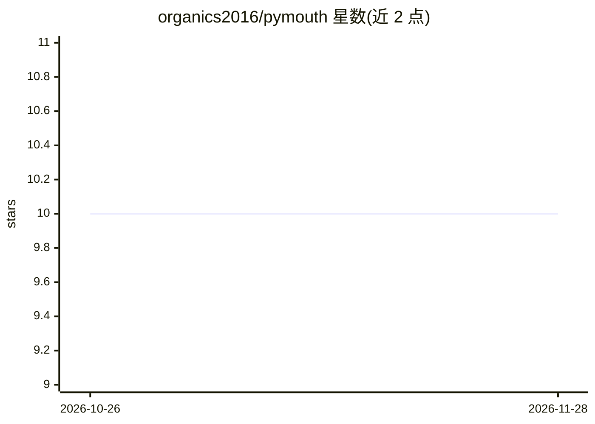

# organics2016/pymouth

⭐ 10 · Python · MIT · 推送 2026-02-09 · [GitHub](https://github.com/organics2016/pymouth) · 个人维护 · 中文 README

**Python 的 Live2D 口型同步库，让皮套随音频开口**

基于 Python 的 Live2D 口型同步库：读取音频文件或 ndarray（如 AI TTS 输出），用动态时间规划算法（DTW）匹配音频中的元音，以 softmax 置信度方式输出，不使用 AI 模型。提供 High Level API（VTubeStudio 适配器 VTSAdapter，含阻塞/非阻塞播放、播放中打断）与 Low Level API（可脱离 VTubeStudio 与其他皮套引擎结合）。以 pip 包形式发布，要求 Python>=3.10，VTubeStudio 为可选项。

## 筛选速览

| 维度 | 判定 | 备注 |
|---|---|---|
| AI 角色 | `ai-enhanced` | 去掉 AI 部分产品仍成立 |
| 许可风险 | `permissive` | MIT |
| 部署形态 | `library` | 以包/库形式分发 |
| 模型依赖 | — | README 未给出锁定关系 |
| 硬件要求 | — | 无带数字的原话,不猜 |
| 安装摩擦 | `low` | 无编译、无系统依赖或容器化 |
| 成熟度 | — | 结构信号不足 |

## 能力要点

- DTW 元音匹配 + softmax 置信度输出，不依赖 AI 模型
- 支持音频文件、SoundFile 对象、ndarray 三种音频输入
- 提供 VTubeStudio 适配器（High Level）与通用 Low Level API 两层接口
- 支持播放中打断（interrupt_listening 参数）

## 适用场景

- 让 AI TTS 的输出直接驱动 Live2D 皮套口型
- 为 VTuber 直播工具集成音频驱动的口型同步
- 不用 VTubeStudio，用自己的皮套引擎接入音频分析能力

## 场景标签

 · 领域:虚拟形象/直播工具

## 证据(README 行号)

> L10: `pymouth` 是基于Python的Live2D口型同步库. 你可以用音频文件, 甚至是AI模型输出的ndarray,
> L16: - 采用动态时间规划算法(DTW)匹配音频中的元音，并以元音置信度(softmax)的方式输出，而不是使用AI模型，即使是移动端CPU也绰绰有余。

## 星数曲线

2026-10-26 10 → 2026-11-28 10（+0）

---
*卡片 v1 · prompt 1.4 · 生成 2026-11-19 · 置信度 high · 依据 README sha `f89dbafd7a6f` · [字段定义](../../DATASET.md)*
