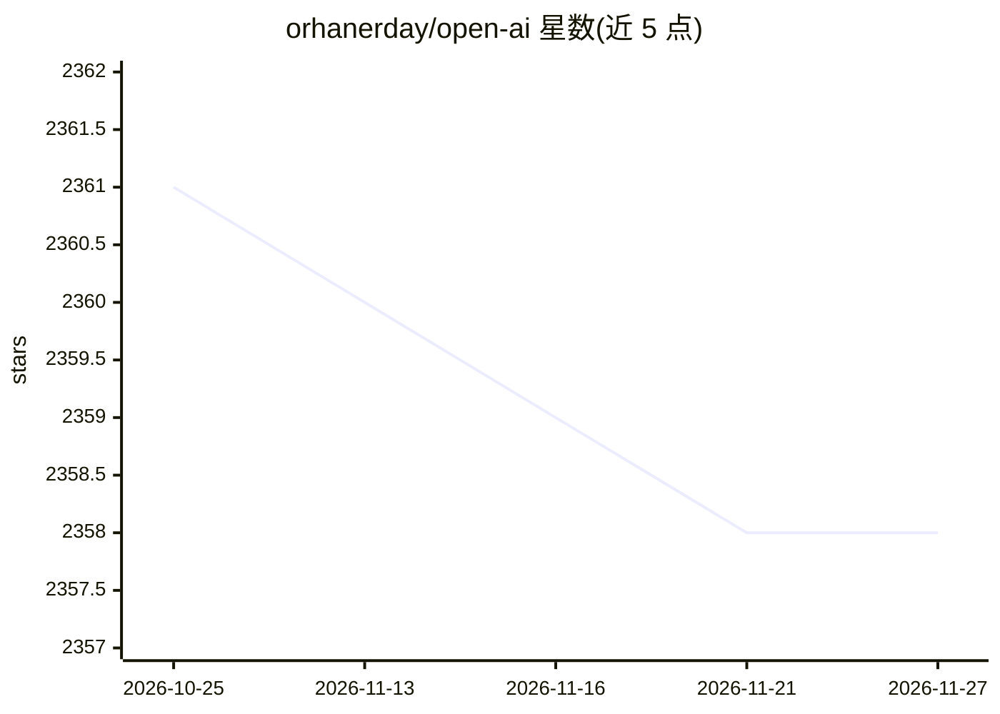

# orhanerday/open-ai

⭐ 2,358 · PHP · MIT · 推送 2026-10-21 · [GitHub](https://github.com/orhanerday/open-ai) · 个人维护

**给 PHP 开发者的 OpenAI REST API 客户端库**

社区维护的 OpenAI REST API PHP 客户端，要求 PHP 7.4+ 及原生 cURL、JSON 扩展，无第三方运行时依赖。为 Chat、Images、Embeddings、Audio、Files、Fine-tunes、Moderation、Responses、Vector Stores、Batches 等端点提供专用方法，无专用方法的端点可用通用 `request()` 调用；支持流式回调（SSE chunk）、multipart 上传、代理、自定义 header 与 cURL 选项，可通过 `setBaseURL()` 接入 OpenAI 兼容 API。WebSocket 与 workload identity token 需单独客户端。

## 筛选速览

| 维度 | 判定 | 备注 |
|---|---|---|
| AI 角色 | `ai-ecosystem` | LLM/agent 周边工具 |
| 许可风险 | `permissive` | MIT |
| 部署形态 | `None` |  |
| 模型依赖 | — | README 未给出锁定关系 |
| 硬件要求 | — | 无带数字的原话,不猜 |
| 安装摩擦 | `low` | 无编译、无系统依赖或容器化 |
| 成熟度 | — | 结构信号不足 |

## 能力要点

- 覆盖 Chat/Images/Embeddings/Audio/Fine-tunes 等端点的专用方法，另有通用 `request()`
- 流式调用通过回调交付 SSE chunk，chat() 与 createResponse() 均支持
- setBaseURL/setApiVersion 支持 OpenAI 兼容提供商（示例含 ByteDance Ark）
- 仅依赖 PHP 7.4+ 原生 cURL 与 JSON 扩展

## 适用场景

- 在 PHP/Laravel/Symfony 项目中接入 OpenAI 聊天与嵌入接口
- 通过流式回调在网页端实现逐字输出
- 用通用 request() 调用 Containers、Evals 等无专用方法的端点

## 场景标签

 · 领域:LLM 基础设施/客户端 SDK

## 证据(README 行号)

> L5: A community-maintained PHP client for the OpenAI REST API, with streaming support.
> L79: - `setBaseURL()` and `setApiVersion()` apply, so it also works with OpenAI-compatible providers.
> L169: - Chat

## 星数曲线

2026-10-25 2,361 → 2026-11-27 2,358（-3）

---
*卡片 v1 · prompt 1.4 · 生成 2026-11-23 · 置信度 high · 依据 README sha `c3c5bd5ae1e2` · [字段定义](../../DATASET.md)*
