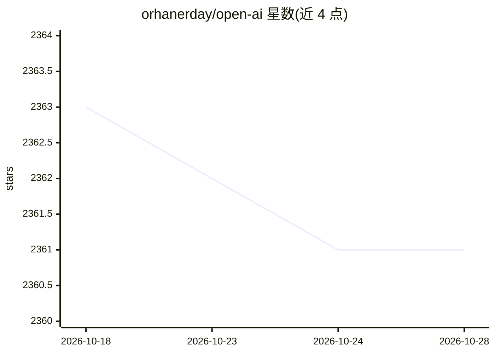

# orhanerday/open-ai

⭐ 2,361 · PHP · MIT · 推送 2026-10-21 · [GitHub](https://github.com/orhanerday/open-ai) · 个人维护

**社区维护的 OpenAI REST API PHP SDK**

用原生 cURL 与 JSON 扩展实现的 OpenAI REST API PHP 客户端，无第三方运行时依赖，要求 PHP 7.4+。提供 Chat、Images、Embeddings、Audio（TTS/转录/翻译）、Files、Fine-tunes、Moderation、Responses、Agents、Vector Stores、Batches、Realtime REST 等端点的专用方法，并通过通用 request() 访问无专用方法的 REST 端点；支持流式回调、multipart 上传、代理、自定义 Base URL 与 API 版本（可对接 OpenAI 兼容服务，如 ByteDance Ark）。面向在 PHP 项目中接入 OpenAI API 的开发者，通过 Composer 安装。

## 筛选速览

| 维度 | 判定 | 备注 |
|---|---|---|
| AI 角色 | `ai-ecosystem` | LLM/agent 周边工具 |
| 许可风险 | `permissive` | MIT |
| 部署形态 | `None` |  |
| 模型依赖 | — | README 未给出锁定关系 |
| 硬件要求 | — | 无带数字的原话,不猜 |
| 安装摩擦 | `low` | 无编译、无系统依赖或容器化 |
| 成熟度 | — | 结构信号不足 |

## 能力要点

- 无第三方运行时依赖，仅用 PHP 原生 cURL 与 JSON 扩展
- 通用 request() 方法覆盖无专用方法的所有 REST 端点
- 支持 SSE 流式回调、multipart 文件上传与代理/自定义 cURL 选项
- setBaseURL/setApiVersion 可对接 OpenAI 兼容 API

## 适用场景

- 在 PHP/Laravel/Symfony 项目中调用 OpenAI 的 Chat、图像、音频等 API
- 通过通用 request() 访问 Containers、Evals、组织管理等新端点
- 对接 OpenAI 兼容的第三方服务（如 ByteDance Ark）
- 构建流式输出的浏览器 SSE 转发服务

## 场景标签

`模型网关` · 领域:Agent 开发

## 证据(README 行号)

> L5: A community-maintained PHP client for the OpenAI REST API, with streaming support.
> L71: - `setBaseURL()` and `setApiVersion()` apply, so it also works with OpenAI-compatible providers.

## 星数曲线

2026-10-18 2,363 → 2026-10-28 2,361（-2）

---
*卡片 v1 · prompt 1.4 · 生成 2026-10-21 · 置信度 high · 依据 README sha `f71443452e35` · [字段定义](../../DATASET.md)*
