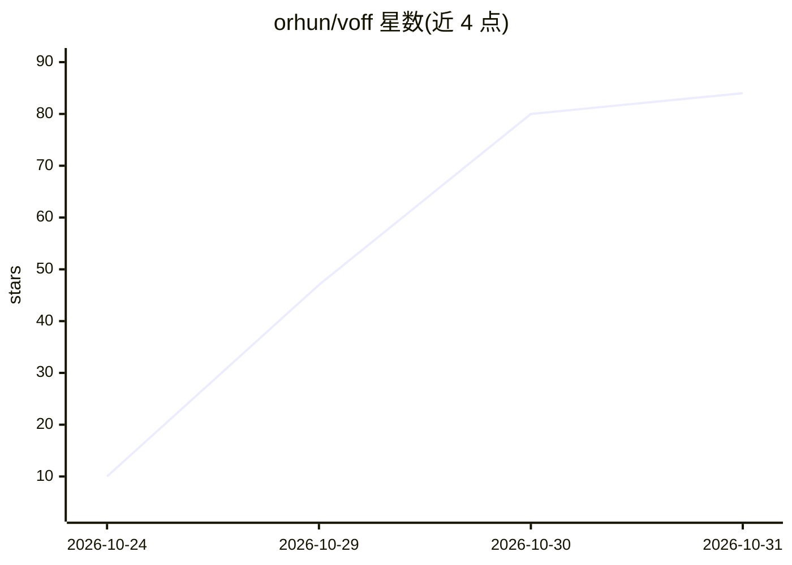

# orhun/voff

⭐ 84 · Rust · Apache-2.0 · 推送 2026-10-28 · [GitHub](https://github.com/orhun/voff) · 个人维护

**Rust TUI 的编码 agent 团队编排工具：自动组队并行执行任务**

基于 Rust/ratatui 的终端工作流构建器，面向编码 agent：按项目自动创建 agent 团队，由 lead 分派任务并行执行，经审批后写入工作区，并提供内置评审与验收检查。支持混用 Codex、Claude 与 Ollama 的不同提供方与模型，支持嵌套团队、并行任务、token 用量与每 agent 成本估算，配置保存于 .voff/config.toml。安装途径为 cargo install 或 Arch Linux 包。

## 筛选速览

| 维度 | 判定 | 备注 |
|---|---|---|
| AI 角色 | `ai-ecosystem` | LLM/agent 周边工具 |
| 许可风险 | `permissive` | Apache-2.0 |
| 部署形态 | `library` | 以包/库形式分发 |
| 模型依赖 | local-ok | 支持本地模型 |
| 硬件要求 | — | 无带数字的原话,不猜 |
| 安装摩擦 | `low` | 无编译、无系统依赖或容器化 |
| 成熟度 | — | 结构信号不足 |

## 能力要点

- 按项目自动生成 agent 团队并并行执行任务
- 可在同一团队混用 Codex、Claude、Ollama 的模型
- lead 依据验收准则检查结果、请求修复并整合
- 跟踪 token 用量与每 agent 成本估算

## 适用场景

- 给项目组建多 agent 团队并行拆分实现任务
- 在终端实时查看任务从计划到落地的流程
- 混用不同提供方的编码模型组成协作团队

## 场景标签

`Agent 框架` `多智能体` `编码 Agent` · 领域:Agent 开发

## 证据(README 行号)

> L40: - Mix providers and models from **Codex**, **Claude**, and **Ollama** in one team.
> L17: 2. Assign a task and have agents implement it in parallel.

## 星数曲线

2026-10-24 10 → 2026-10-31 84（+74）

---
*卡片 v1 · prompt 1.4 · 生成 2026-10-28 · 置信度 high · 依据 README sha `3f20ffa7d8c7` · [字段定义](../../DATASET.md)*
