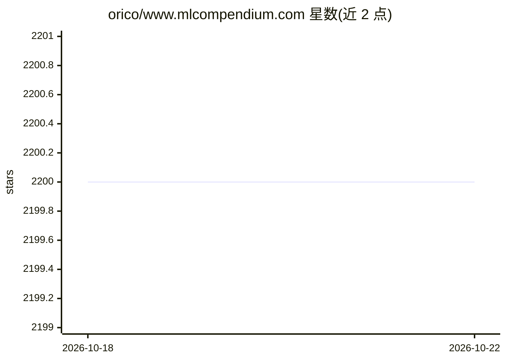

# orico/www.mlcompendium.com

⭐ 2,200 · 推送 2026-10-01 · [GitHub](https://github.com/orico/www.mlcompendium.com) · [官网](https://www.mlcompendium.com) · 个人维护

**开源机器学习知识汇编书：502 个主题的学习资源导航**

由 Dr. Ori Cohen 维护的开放知识书籍（前身 ML Compendium），从私人资源清单演变为公开在线书，覆盖 502 个主题：机器学习与深度学习算法、LLM、NLP、计算机视觉、时间序列、异常检测等，以及数据科学管理、团队建设、产品管理与技术栈等战略与实践主题，Ops 部分讲解系统构建、交付与治理。源码托管于 GitHub，声明非营利、永久免费，读者可通过 GitHub 贡献。

## 筛选速览

| 维度 | 判定 | 备注 |
|---|---|---|
| AI 角色 | `ai-knowledge` | 知识聚合/清单类 |
| 许可风险 | `none` | — |
| 部署形态 | `None` |  |
| 模型依赖 | — | README 未给出锁定关系 |
| 硬件要求 | — | 无带数字的原话,不猜 |
| 安装摩擦 | `low` | 无编译、无系统依赖或容器化 |
| 成熟度 | — | 结构信号不足 |

## 能力要点

- 覆盖 502 个主题的摘要、链接与文章汇编
- 范围从业务问题贯穿数据、AI、工程到产品
- 完全开放源码，声明非营利且免费
- 曾在 Medium 发布配套介绍文章

## 适用场景

- 按阅读路径系统学习机器学习与深度学习
- 数据科学团队查找管理与产品方面的实践参考
- 查找各领域（NLP/视觉/时序/图）的作者与资源线索

## 场景标签

`精选清单` · 领域:学习与行业

## 证据(README 行号)

> L15: The AI Compendium was previously the Machine & Deep Learning Compendium, also known as the ML Compendium and the ML
> L21: The scope is wide on purpose. Covering **502 topics**, the ML and DL Compendium includes summaries, links, and arti

## 星数曲线

2026-10-18 2,200 → 2026-10-22 2,200（+0）

---
*卡片 v1 · prompt 1.4 · 生成 2026-10-21 · 置信度 high · 依据 README sha `5a4ca4e6fabc` · [字段定义](../../DATASET.md)*
