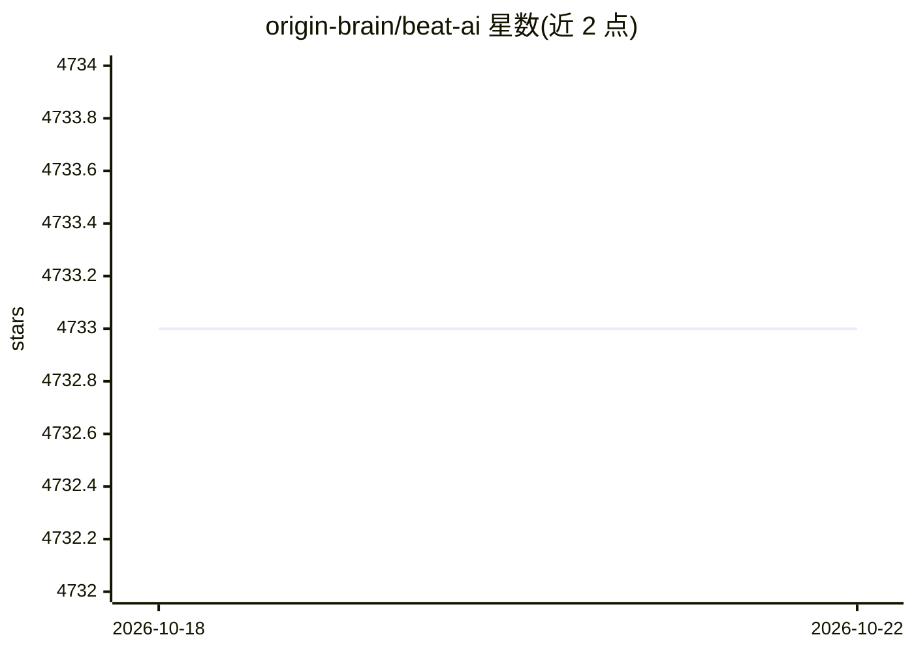

# origin-brain/beat-ai

⭐ 4,733 · JavaScript · 推送 2026-08-20 · [GitHub](https://github.com/origin-brain/beat-ai) · [官网](https://beatai.org) · 个人维护 · 中文 README

**面向学生到工程师的 AI 入门教学内容站（beatai.org）**

BeatAI 是一个发布 AI 学习与工程文章的内容站点，README 以时间线形式列出近期文章摘要：涵盖神经网络、Transformer 原理、大模型（MoE）、Agentic AI、上下文工程、agent 可观测性与评估、自训练算法等主题。文章形式包括从第一性原理用 PyTorch 手动构建 Transformer 等教程，面向从学生到工程师的学习者。README 未给出安装或代码运行方式，内容通过网站 beatai.org 阅读。

## 筛选速览

| 维度 | 判定 | 备注 |
|---|---|---|
| AI 角色 | `ai-knowledge` | 知识聚合/清单类 |
| 许可风险 | `none` | — |
| 部署形态 | `None` |  |
| 模型依赖 | — | README 未给出锁定关系 |
| 硬件要求 | — | 无带数字的原话,不猜 |
| 安装摩擦 | `low` | 无编译、无系统依赖或容器化 |
| 成熟度 | — | 结构信号不足 |

## 能力要点

- 按时间线持续发布 AI 学习与工程文章
- 主题覆盖 Transformer 原理、MoE、Agentic AI、可观测性/评估
- 含从零用 PyTorch 手写 Transformer 的系列教程

## 适用场景

- 系统学习神经网络到大模型的基础与原理
- 了解 Agentic AI、上下文工程等工程实践
- 跟读从零实现 Transformer 的代码教程

## 场景标签

`教程课程` · 领域:学习与行业

## 证据(README 行号)

> L3: > 最近 30 天发布 · 完整列表见 <https://beatai.org/ai-insights>
> L31: - 我在 MacBook 上从零开始构建了一个 GPT——第 1-5 天：从二元语法到可运行的自注意力头

## 星数曲线

2026-10-18 4,733 → 2026-10-22 4,733（+0）

---
*卡片 v1 · prompt 1.4 · 生成 2026-10-20 · 置信度 high · 依据 README sha `8ca6cfe8eedc` · [字段定义](../../DATASET.md)*
