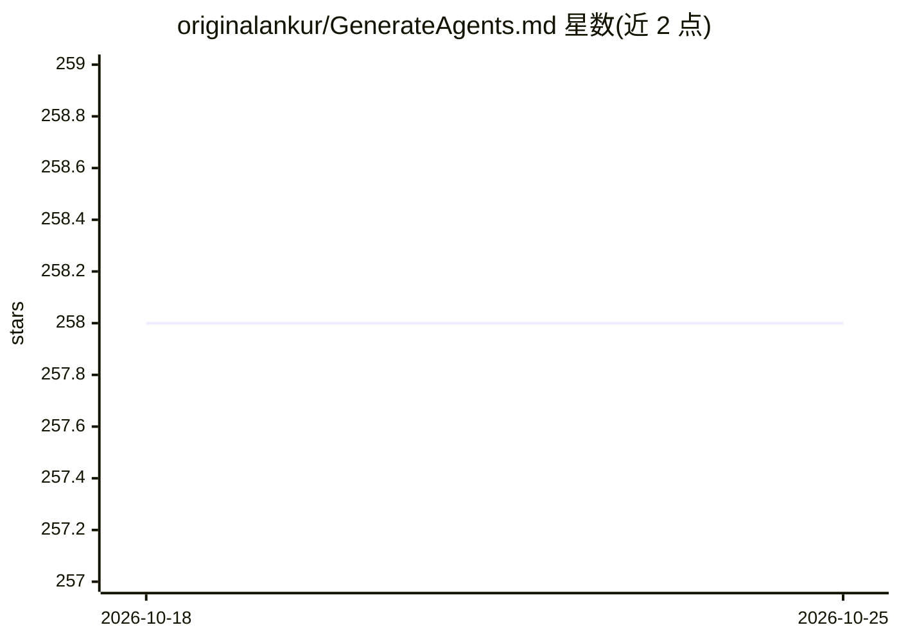

# originalankur/GenerateAgents.md

⭐ 258 · Python · MIT · 推送 2026-03-03 · [GitHub](https://github.com/originalankur/GenerateAgents.md) · 个人维护

**自动为 GitHub/本地仓库生成 AGENTS.md 的 CLI 工具**

基于 dspy.RLM（Recursive Language Models）分析本地或 GitHub 仓库，生成面向 AI agent 的 AGENTS.md 文件。支持两种输出风格：Comprehensive（含架构概览）与 Strict（仅约束与反模式）；可扫描 Git 提交历史中被 revert 的提交，提取 Lessons Learned 与 Anti-Patterns。通过 LiteLLM 支持 100+ LLM 提供商，仅需一个提供商 API key，默认模型为 Gemini 2.5 Pro。以 uv 管理的 Python 项目提供，克隆源码安装后经 CLI 运行。

## 筛选速览

| 维度 | 判定 | 备注 |
|---|---|---|
| AI 角色 | `ai-native` | 本体是模型或模型工具 |
| 许可风险 | `permissive` | MIT |
| 部署形态 | `None` |  |
| 模型依赖 | local-ok | 支持本地模型 |
| 硬件要求 | — | 无带数字的原话,不猜 |
| 安装摩擦 | `low` | 无编译、无系统依赖或容器化 |
| 成熟度 | — | 结构信号不足 |

## 能力要点

- 基于 dspy.RLM 递归语言模型的长上下文仓库分析
- Git 历史中 revert 提交的反模式提取（默认回看 500 提交）
- Strict 与 Comprehensive 两种输出风格
- 经 LiteLLM 支持 100+ LLM 提供商，支持本地端点

## 适用场景

- 为新接手的仓库快速生成给 AI agent 的项目说明文件
- 从历史 revert 提交中沉淀反模式供 agent 规避
- 为不同 agent 设置选择精简或全面的 AGENTS.md 风格

## 场景标签

`AI 写作` · 领域:内容生成

## 证据(README 行号)

> L3: **Automatically generate Agents.md for any GitHub / Local Repository. Long context enabled using dspy.RLM aka Recurs
> L5: GenerateAgents.md analyzes local or GitHub repositories using Recursive Language Models (dspy.RLM) to produce optimi

## 星数曲线

2026-10-18 258 → 2026-10-25 258（+0）

---
*卡片 v1 · prompt 1.4 · 生成 2026-10-22 · 置信度 high · 依据 README sha `035891d00bbc` · [字段定义](../../DATASET.md)*
