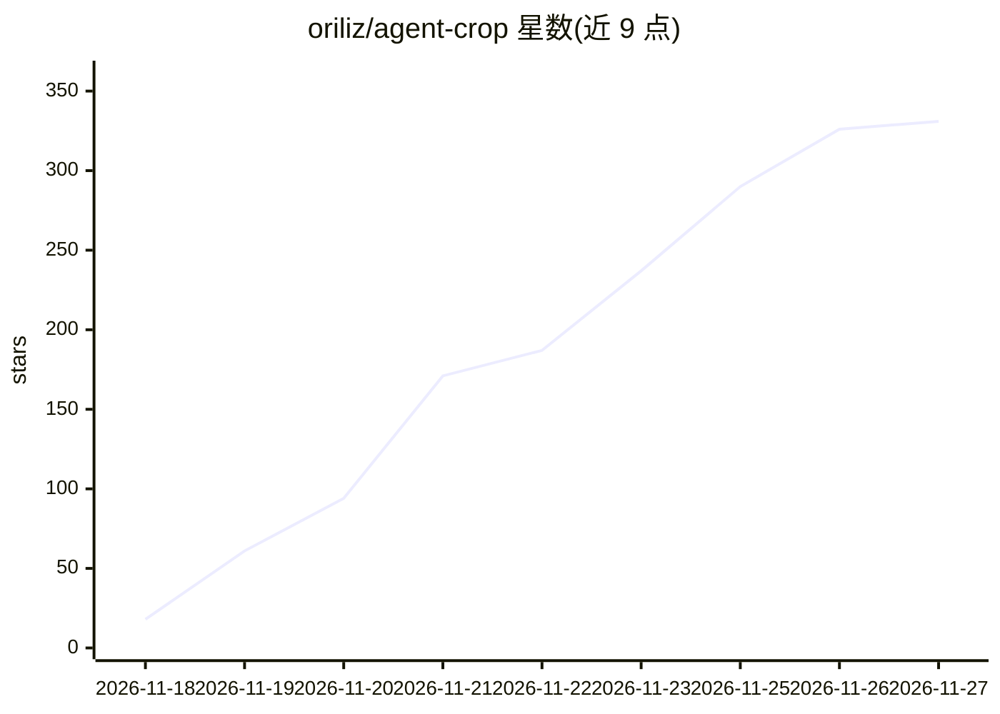

# oriliz/agent-crop

⭐ 331 · Python · MIT · 推送 2026-11-20 · [GitHub](https://github.com/oriliz/agent-crop) · 个人维护 · 中文 README

**给 AI 编程助手做本地时间观测与复盘改进的插件工具**

Agent Crop 以 DSH/Claude Code/Codex 插件形式运行，通过探针在会话各节点自动采集时间与工具调用事件（JSONL 本地存储），超时注入提醒并要求 AI 上报卡点原因，按九类枚举归因后沉淀为 work_summary，形成测量→归因→改指令→再测量的闭环。配套面板提供会话时间轴、跨会话摩擦指标与采集健康度视图。数据仅存本机权限 0700 目录，不存对话正文、不上传。README 自述工具仍在开发中，部分字段覆盖率不高。

## 筛选速览

| 维度 | 判定 | 备注 |
|---|---|---|
| AI 角色 | `ai-ecosystem` | LLM/agent 周边工具 |
| 许可风险 | `permissive` | MIT |
| 部署形态 | `library` | 以包/库形式分发 |
| 模型依赖 | — | README 未给出锁定关系 |
| 硬件要求 | — | 无带数字的原话,不猜 |
| 安装摩擦 | `low` | 无编译、无系统依赖或容器化 |
| 成熟度 | `idea` | |

## 能力要点

- 本地 JSONL 自动采集工具调用与时间事件，数据不上传
- 超时注入鞭策并要求 AI 通过 crop_update 上报 cause/verdict/category（九类枚举）
- 提供会话时间轴面板与跨会话摩擦指标、采集健康度视图
- crop health 支持 --json 机器读输出，并以 MCP 工具暴露

## 适用场景

- 排查 AI 编程助手一个下午的时间究竟花在哪里
- 把 AI 反复试错的模式归因后沉淀成新的 Skill/指令
- 检查多宿主环境下事件采集器本身是否正常工作

## 场景标签

`编码 Agent` `LLM 可观测性` `模型评测` · 领域:编码与开发

## 证据(README 行号)

> L7: **Agent Crop 是给 AI 的一根马鞭：催它交活，逼它复盘，让它自己越用越顺。**
> L44: 这里的「自进化」是一条**有数据与事实支撑的闭环**：
> L161: - DSH 插件：工具 `crop_health`（参数 `days` / `host`），怀疑数据不可信时直接调。

## 星数曲线

2026-11-18 18 → 2026-11-27 331（+313）

---
*卡片 v1 · prompt 1.4 · 生成 2026-11-25 · 置信度 high · 依据 README sha `24eb04583658` · [字段定义](../../DATASET.md)*
