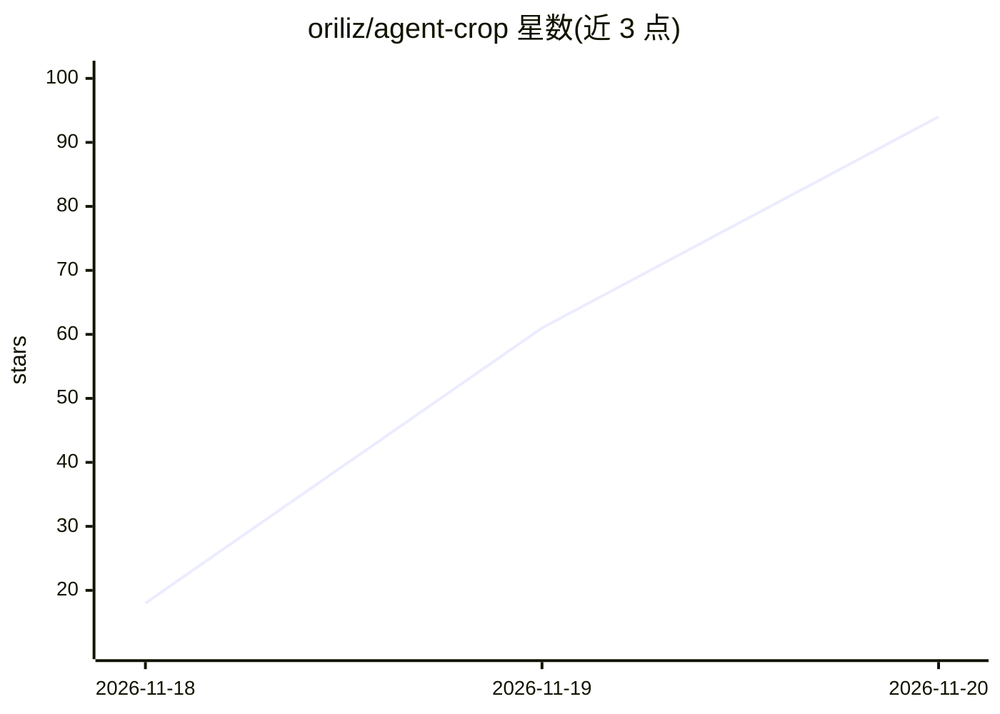

# oriliz/agent-crop

⭐ 94 · Python · MIT · 推送 2026-11-19 · [GitHub](https://github.com/oriliz/agent-crop) · 个人维护 · 中文 README

**AI 编程助手的时间观测与自改进插件：本地记录时间去向并写回改进**

以 DSH 插件与 Claude Code（MCP）形式接入 AI 编程助手的观测与鞭策工具：在会话各节点自动采集工具调用、轮间等待、返工信号等事件，落为本地 JSONL（不上传、权限 0700）；超时注入鞭策提示，AI 通过 crop_update 上报 phase/cause/category（九类枚举）；配合会话页时间轴面板、跨会话摩擦指标与健康度视图，形成测量→归因→改指令/技能/工具→再测量的闭环。自带 crop status/health CLI。作者声明工具仍在开发中。

## 筛选速览

| 维度 | 判定 | 备注 |
|---|---|---|
| AI 角色 | `ai-ecosystem` | LLM/agent 周边工具 |
| 许可风险 | `permissive` | MIT |
| 部署形态 | `library` | 以包/库形式分发 |
| 模型依赖 | — | README 未给出锁定关系 |
| 硬件要求 | — | 无带数字的原话,不猜 |
| 安装摩擦 | `low` | 无编译、无系统依赖或容器化 |
| 成熟度 | `idea` | |

## 能力要点

- 会话级事件采集（工具成败、等待、返工信号）落本地 JSONL，不存对话正文
- 超时鞭策注入 + AI 经 crop_update 上报九类卡点归因
- 会话页时间轴面板与跨会话摩擦指标、采集健康度视图
- 四种鞭策风格人设，运行中切换无需重启

## 适用场景

- 弄清 AI 编程助手跑一个下午的时间都花在哪
- 把复盘结果写回 agent 指令/技能/工具并验证改动效果
- 监控采集器自身健康度，判断数据可信度

## 场景标签

`LLM 可观测性` · 领域:评测与运维

## 证据(README 行号)

> L92: - **起点**：会话开始。探针先往上下文里注一句——**创建 / 绑定工作项**，然后才开始记东西。
> L97: - **超时**：到点先记一次超时提醒，再注入一句鞭策（图上红色那一对，鞭策带个小鞭子）；被抽完，AI 要**反思与上报**——调 `crop_update` 写下 `cause` / `verdict` / `category`

## 星数曲线

2026-11-18 18 → 2026-11-20 94（+76）

---
*卡片 v1 · prompt 1.4 · 生成 2026-11-18 · 置信度 high · 依据 README sha `11fe041c64f6` · [字段定义](../../DATASET.md)*
