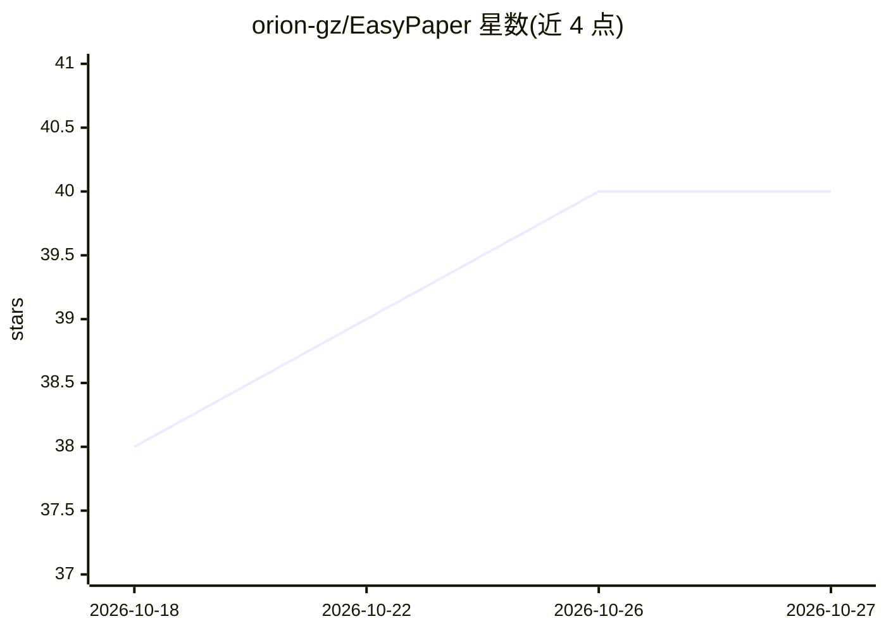

# orion-gz/EasyPaper

⭐ 40 · JavaScript · 推送 2026-10-26 · [GitHub](https://github.com/orion-gz/EasyPaper) · 个人维护

**面向 PDF 文献的 AI 翻译、阅读与讨论工作台（桌面/网页）**

EasyPaper 是一个 Web 与桌面端 PDF 工作区，支持双语对照翻译（句级对齐）、AI 对话、预读摘要、词汇辅助、标注与浮动便签、参考文献/图表/公式覆盖层，以及研究图谱、阅读统计与推荐。提供研究模式与通用文档模式两种阅读方式。可接入本地 Ollama、Gemini、Claude、OpenAI，或检测到的 agy/claude/codex CLI 提供方。桌面端为 Tauri 应用（含后端 sidecar，无需另装 Python/Node.js），也可从源码运行或 Docker 自部署；桌面构建未签名，首次启动会触发系统安全提示。

## 筛选速览

| 维度 | 判定 | 备注 |
|---|---|---|
| AI 角色 | `ai-native` | 本体是模型或模型工具 |
| 许可风险 | `none` | — |
| 部署形态 | `desktop` | 安装包/桌面程序 |
| 模型依赖 | local-ok | 支持本地模型 |
| 硬件要求 | — | 无带数字的原话,不猜 |
| 安装摩擦 | `low` | 无编译、无系统依赖或容器化 |
| 成熟度 | — | 结构信号不足 |

## 能力要点

- 原文与 AI 翻译并排显示，句级对齐
- 研究模式提供文献结构、研究图谱、阅读分析与推荐
- 标注/高亮/浮动便签与批注 PDF 导出
- 支持本地 Ollama 与多家 API 提供方及 CLI 提供方

## 适用场景

- 阅读英文论文时做双语对照翻译与 AI 问答
- 整理文献库并追踪阅读记录与研究图谱
- 团队或个人自部署一个 PDF 阅读/标注工作区

## 场景标签

`科研工具` `文档问答` · 领域:知识与检索

## 证据(README 行号)

> L11: EasyPaper is a web and desktop workspace for translating, reading, annotating, and discussing PDFs with AI. Use loc
> L42: - Side-by-side source and AI translation with sentence-level alignment
> L44: - Research workspace with library, AI Chats, research graph, reading analytics, and recommendations

## 星数曲线

2026-10-18 38 → 2026-10-27 40（+2）

---
*卡片 v1 · prompt 1.4 · 生成 2026-10-25 · 置信度 mid · 依据 README sha `8228d74000fe` · [字段定义](../../DATASET.md)*
