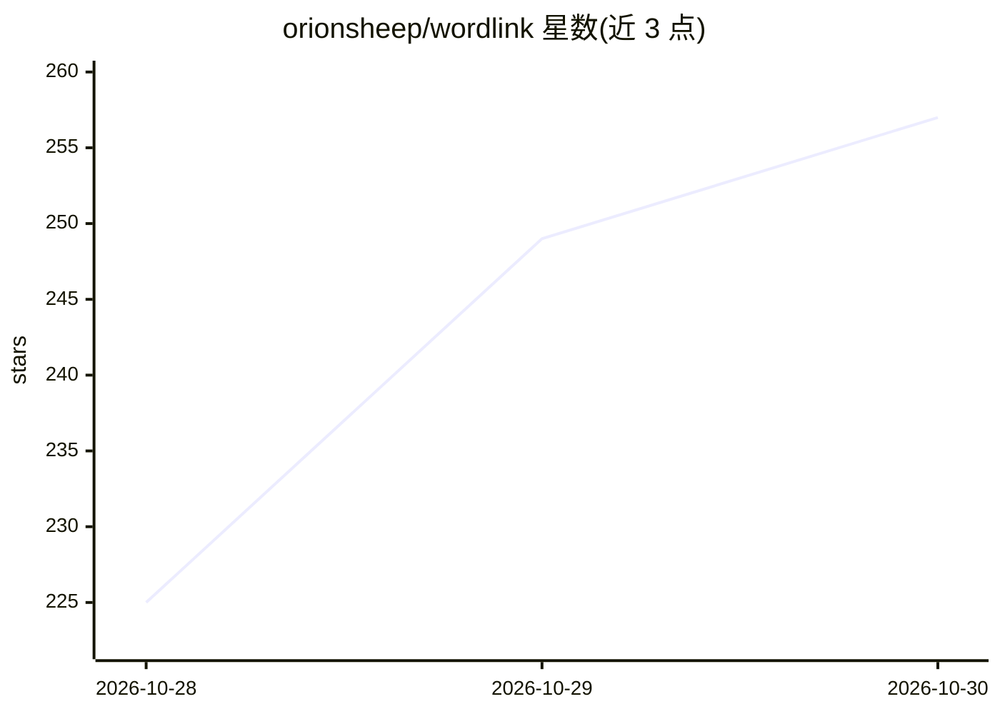

# orionsheep/wordlink

⭐ 257 · TypeScript · MIT · 推送 2026-10-28 · [GitHub](https://github.com/orionsheep/wordlink) · [官网](https://wordlink.lifeplayertribe.com) · 组织维护 · 中文 README

**基于 326k 词链图的英语词汇学习工作台，附微调模型**

开源英语词汇学习工作区：以从开放词典挖掘的 326k 条类型化词链（同义、近义、词族、形近词）构成词图，提供测验、分级阅读、记忆状态追踪与 AI 导师聊天。仓库同时包含 WordLink-Edge 模型的 SFT+DPO 训练流水线与基准——Qwen2.5-1.5B 微调后按 CEFR 等级用目标词生成短故事。限制：Web 应用尚未运行该模型，AI 功能调用 OpenAI 兼容 API（L124-125）。面向学习者，Node.js+Docker 部署。

## 筛选速览

| 维度 | 判定 | 备注 |
|---|---|---|
| AI 角色 | `ai-enhanced` | 去掉 AI 部分产品仍成立 |
| 许可风险 | `permissive` | MIT |
| 部署形态 | `library` | 以包/库形式分发 |
| 模型依赖 | — | README 未给出锁定关系 |
| 硬件要求 | — | 无带数字的原话,不猜 |
| 安装摩擦 | `low` | 无编译、无系统依赖或容器化 |
| 成熟度 | — | 结构信号不足 |

## 能力要点

- 326k 条类型化词链构成的可视化词图与学习进度环
- 测验答案驱动的 UNFAMILIAR→MASTERED 记忆状态与复习调度
- WordLink-Edge：Qwen2.5-1.5B SFT+DPO 微调，目标词命中率 63%→88%
- DEMO_MODE 下无需 auth 服务器即可运行，AI 功能为可选

## 适用场景

- 通过词的邻域网络复习和掌握英语词汇
- 在分级阅读中点词查义并查看关联词图
- 获取用自己复习词表生成的分级短故事

## 场景标签

`微调` · 领域:训练与推理

## 证据(README 行号)

> L5: An open-source vocabulary workspace built on a graph of **326k typed word links**: synonyms, near-synonyms,
> L74: - **AI features** (tutor chat, story generation, passport report) call any OpenAI-compatible endpoint:
> L124: > **Status.** The model is trained and benchmarked, but the web app does not run it yet: its AI features call

## 星数曲线

2026-10-28 225 → 2026-10-30 257（+32）

---
*卡片 v1 · prompt 1.4 · 生成 2026-10-28 · 置信度 mid · 依据 README sha `5557925e6b05` · [字段定义](../../DATASET.md)*
