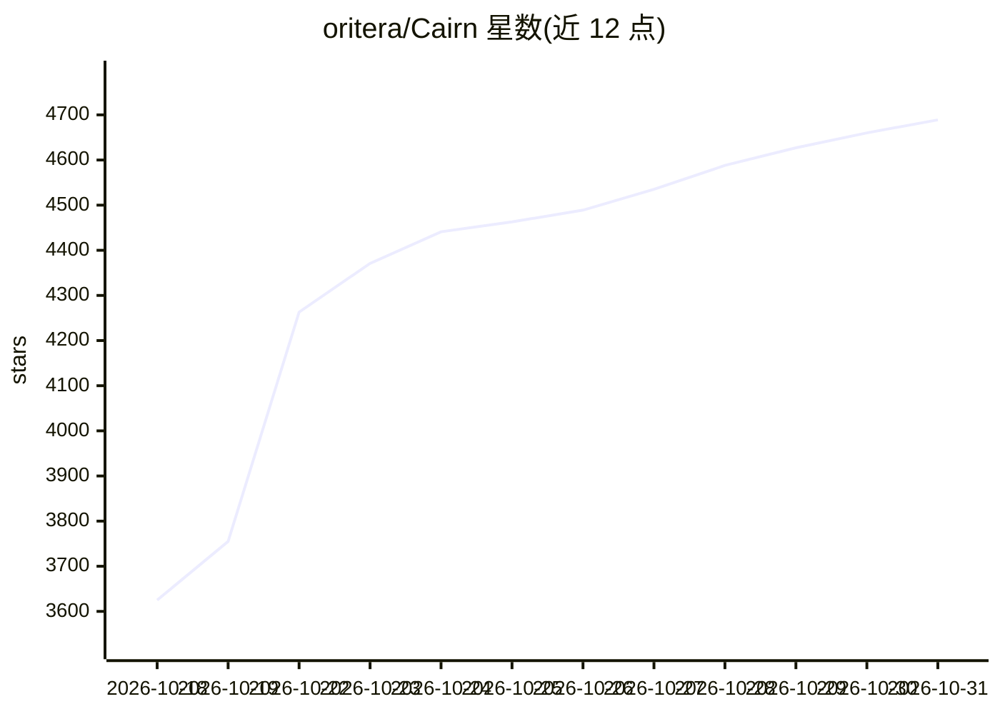

# oritera/Cairn

⭐ 4,689 · Python · AGPL-3.0 · 推送 2026-09-07 · [GitHub](https://github.com/oritera/Cairn) · 组织维护 · 中文 README

**通用 AI 状态空间搜索引擎，先在自动化渗透测试上验证**

面向具有明确起点与目标的未知路径问题（渗透测试、CTF、漏洞研究等）的问题求解引擎：基于黑板架构与事实-意图图（Fact/Intent/Hint 三原语），Agent Worker 以 OODA 循环读写共享图并通过 Stigmergy 协作，Cairn Server 维护图一致性，Dispatcher 调度任务并按项目创建 Worker 容器。支持 Claude Code、Codex、Pi 三种 worker 后端，可用 Docker Compose 或本地模式运行（本地模式无需 Docker，复用已登录的 CLI）。在腾讯云 Hackathon 渗透挑战赛中解出全部 54 题。AGPLv3 许可，另提供商业许可选项；声明仅限授权环境使用。

## 筛选速览

| 维度 | 判定 | 备注 |
|---|---|---|
| AI 角色 | `ai-ecosystem` | LLM/agent 周边工具 |
| 许可风险 | `dual` | AGPL-3.0 |
| 部署形态 | `self-host` | docker 或自建部署 |
| 模型依赖 | — | README 未给出锁定关系 |
| 硬件要求 | — | 无带数字的原话,不猜 |
| 安装摩擦 | `low` | 无编译、无系统依赖或容器化 |
| 成熟度 | — | 结构信号不足 |

## 能力要点

- 黑板架构 + Fact/Intent/Hint 三原语构建状态空间图
- Agent Worker 以 OODA 循环协作，任务运行时从图状态生成而非预定义角色
- 支持 Claude Code / Codex / Pi 三种 worker 后端
- 提供 Docker 容器模式与无需 Docker 的本地模式

## 适用场景

- 在授权环境下进行自动化渗透测试与 CTF 解题
- 探索渗透测试之外的同类结构问题（漏洞研究、数学证明等）
- 研究多 agent 通过共享黑板（Stigmergy）的协作机制

## 场景标签

`多智能体` `网络安全` `Agent 框架` · 领域:Agent 开发

## 证据(README 行号)

> L16: Cairn is a general-purpose problem-solving engine. It defines no roles, no workflows. Given an origin and a goal, i
> L41: The engine is built on a **Blackboard Architecture** with an explicit fact-intent graph. Three primitives are all i
> L80: **Cairn Dispatcher** reads the graph, schedules tasks, spins up and tears down worker containers, and is the sole w
> L84: Supported worker backends: **Claude Code**, **Codex**, and **Pi**.

## 星数曲线

2026-10-18 3,625 → 2026-10-31 4,689（+1,064）

---
*卡片 v1 · prompt 1.4 · 生成 2026-10-20 · 置信度 high · 依据 README sha `5fec609b30b9` · [字段定义](../../DATASET.md)*
