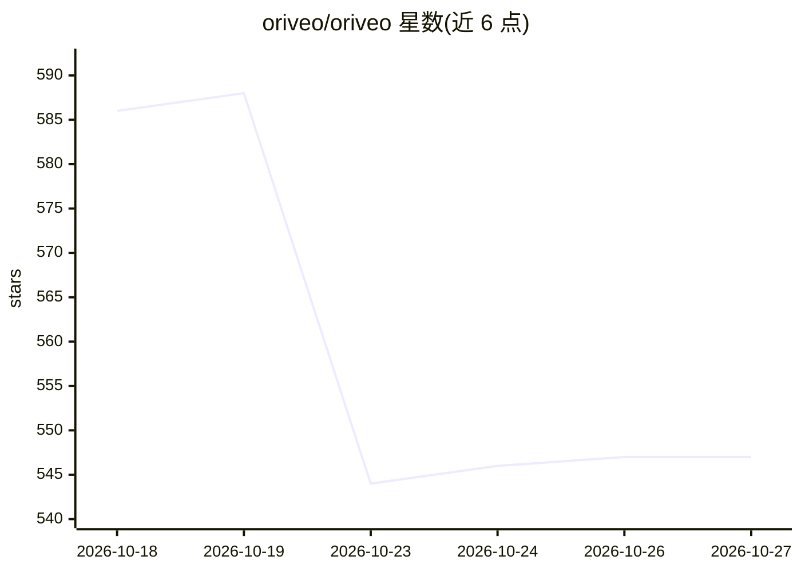

# oriveo/oriveo

⭐ 547 · Swift · AGPL-3.0 · 推送 2026-10-26 · [GitHub](https://github.com/oriveo/oriveo) · [官网](https://oriveoai.com) · 组织维护

**自带 API Key 的多模型 AI 聊天客户端，覆盖 iOS/Android/Web**

开源 BYOK 多模型 AI 聊天客户端，面向希望直接向模型提供商付费、不经过订阅中间层的终端用户。原生接入 OpenAI、Anthropic、Google Gemini、OpenRouter、DeepSeek 等 15 家提供商，并支持任意 OpenAI/Anthropic/Gemini 兼容端点，包括本机运行的 llama.cpp、Ollama、LM Studio、vLLM。会话、笔记、附件默认存于本地设备；支持 MCP 工具、技能、跨模型核验、设备端费用统计与文件导出。本仓库为 Community Edition（AGPL-3.0），无预编译产物，需自行构建：Web 端用 Node 22 + npm，Android 需 JDK 21 与 Android SDK，iOS 需 Xcode 26。另有名为 Oriveo 的商业专有版上架应用商店。

## 筛选速览

| 维度 | 判定 | 备注 |
|---|---|---|
| AI 角色 | `ai-native` | 本体是模型或模型工具 |
| 许可风险 | `viral` | AGPL-3.0 |
| 部署形态 | `library` | 以包/库形式分发 |
| 模型依赖 | local-ok | 支持本地模型 |
| 硬件要求 | — | 无带数字的原话,不猜 |
| 安装摩擦 | `medium` | 含编译或系统依赖之一 |
| 成熟度 | — | 结构信号不足 |

## 能力要点

- 原生支持 15 家模型提供商，另支持任意 OpenAI/Anthropic/Gemini 兼容端点
- 本地模型服务器（llama.cpp/Ollama/LM Studio/vLLM）经 mDNS 自动发现
- MCP 工具、可复用技能、跨模型核验与设备端费用统计
- 会话与密钥默认存于设备，无账号、无分析上报

## 适用场景

- 用一个 App 聊遍多家模型，只付提供商标价
- 手机上直连家里局域网内跑的 Ollama/llama.cpp
- 自托管 Web 客户端，数据不出自己的机器

## 场景标签

`聊天机器人` · 领域:对话与助手

## 证据(README 行号)

> L54: Oriveo Community Edition is an open-source, bring-your-own-key (BYOK) multi-model AI chat client
> L61: It speaks to **15 model providers** natively — OpenAI, Anthropic, Google Gemini, OpenRouter,

## 星数曲线

2026-10-18 586 → 2026-10-27 547（-39）

---
*卡片 v1 · prompt 1.4 · 生成 2026-10-21 · 置信度 high · 依据 README sha `df122933bd1d` · [字段定义](../../DATASET.md)*
