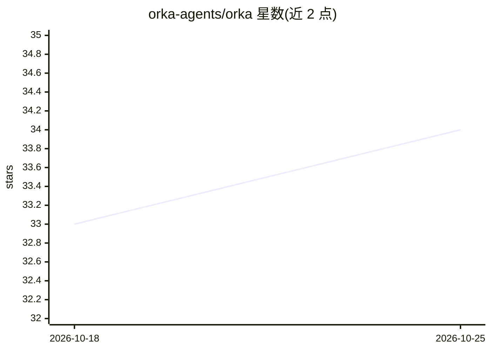

# orka-agents/orka

⭐ 36 · Go · MIT · 推送 2026-10-25 · [GitHub](https://github.com/orka-agents/orka) · [官网](https://orka-agents.github.io/orka/) · 组织维护

**在 Kubernetes 上运行 AI agent 任务的开源编排平台**

面向需要治理与隔离运行 AI 工作的团队：用户以 YAML 定义 Task，平台在 Pod 中运行三类工作——调用模型（Anthropic/OpenAI/Azure OpenAI 或兼容端点）、运行编码代理（Codex、Claude Code、Copilot CLI、OpenCode）、执行任意容器命令。结果通过 REST API、CLI 或内置仪表板读取；模型密钥保存在集群 Secret 中，人员与 CI 持有作用域令牌。通过 Helm 安装到集群，依赖 kubectl 与 kind 亦可。README 声明为实验性，不建议生产使用；项目暂由 Microsoft 政策治理并要求签署 CLA。

## 筛选速览

| 维度 | 判定 | 备注 |
|---|---|---|
| AI 角色 | `ai-ecosystem` | LLM/agent 周边工具 |
| 许可风险 | `permissive` | MIT |
| 部署形态 | `library` | 以包/库形式分发 |
| 模型依赖 | locked-api |  |
| 硬件要求 | — | 无带数字的原话,不猜 |
| 安装摩擦 | `low` | 无编译、无系统依赖或容器化 |
| 成熟度 | `idea` | |

## 能力要点

- Task 以 Pod 形式隔离运行，支持模型调用、编码代理与任意容器命令三类工作
- 模型密钥留在集群 Secret，人员与 CI 使用作用域令牌
- 提供 REST API、CLI 与内置仪表板，密钥治理按 Agent/命名空间配置
- 编码代理可在真实 git 仓库工作并自动开 PR

## 适用场景

- 每个 PR 自动执行代理审查并回帖结果
- 给 issue 打标签后由代理实现并提交 PR
- 定时运行依赖审计、安全扫描等代理任务
- 让 Claude Code、Codex 等工具通过兼容端点接入而无需分发供应商密钥

## 场景标签

`编码 Agent` `Agent 框架` · 领域:Agent 开发

## 证据(README 行号)

> L13: Orka lets you hand a piece of work to an AI agent and get the result back, with
> L22: - **Ask a model.** Orka's own AI worker talks to Anthropic, OpenAI, Azure OpenAI, or any
> L24: - **Run a coding agent.** Codex, Claude Code, GitHub Copilot CLI, or OpenCode, working on

## 星数曲线

2026-10-18 33 → 2026-10-25 34（+1）

---
*卡片 v1 · prompt 1.4 · 生成 2026-10-25 · 置信度 high · 依据 README sha `c977dc25e47f` · [字段定义](../../DATASET.md)*
