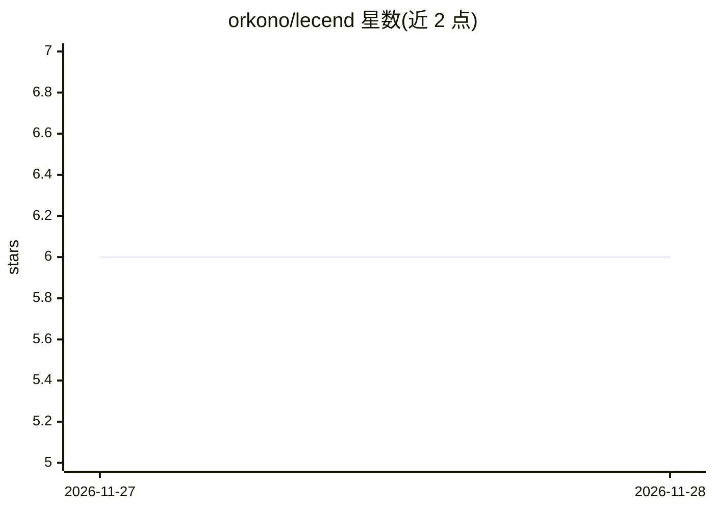

# orkono/lecend

⭐ 6 · Rust · Apache-2.0 · 推送 2026-11-26 · [GitHub](https://github.com/orkono/lecend) · [官网](https://crates.io/crates/lecend) · 个人维护

**Claude Code 会话术语表插件：本地检索短标签含义，不耗模型 token**

面向 Claude Code 长会话的术语表插件：后台捕获会话中出现的短标签（如 W6、D4、Decision 1）的定义与最新状态，存入本地 SQLite 文件；用户用 /lecend 命令查询，结果仅显示、不写入模型上下文。捕获通过用户自己的 Claude 账号调用模型（默认 haiku），每次约 800-3500 token，每会话上限 200 次可关闭。限制：只读取每轮最终可见回答，工具调用之间产生的标签会漏掉；通用标签可能误报。以 Rust 单二进制分发，仅支持 Claude Code。

## 筛选速览

| 维度 | 判定 | 备注 |
|---|---|---|
| AI 角色 | `ai-enhanced` | 去掉 AI 部分产品仍成立 |
| 许可风险 | `permissive` | Apache-2.0 |
| 部署形态 | `desktop` | 安装包/桌面程序 |
| 模型依赖 | locked-api |  |
| 硬件要求 | — | 无带数字的原话,不猜 |
| 安装摩擦 | `low` | 无编译、无系统依赖或容器化 |
| 成熟度 | — | 结构信号不足 |

## 能力要点

- 后台捕获标签定义与状态，本地 SQLite 存储，查询结果不进入模型上下文
- 每次捕获调用约 800-3500 token，预算上限 200 次/会话，可 /lecend off 关闭
- 支持手动 edit/pin/forget 标签、历史版本查看与侧边栏面板
- Rust 单二进制，经 Homebrew cask、cargo 或 GitHub release 归档安装

## 适用场景

- 长时间编码会话中查询早已滚出屏幕的缩写与决策编号含义
- 控制 LLM 用量：用本地查询替代向模型提问标签含义
- 追踪会话中某标签状态的演变历史

## 场景标签

`Agent 记忆` · 领域:Agent 开发

## 证据(README 行号)

> L5: A glossary for long Claude Code sessions.
> L20: is never added to the model's context. Claude Code only.
> L37: To stop it: `/lecend off` for the current session (`/lecend on` resumes), or turn the `capture`

## 星数曲线

2026-11-27 6 → 2026-11-28 6（+0）

---
*卡片 v1 · prompt 1.4 · 生成 2026-11-27 · 置信度 high · 依据 README sha `4a24cccd88a4` · [字段定义](../../DATASET.md)*
