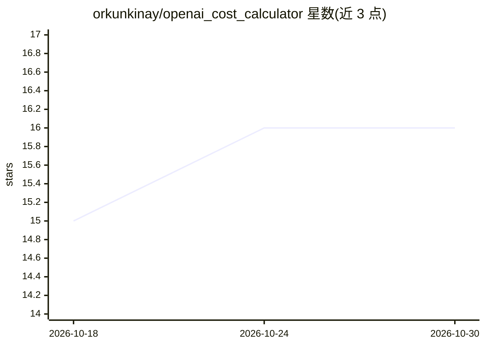

# orkunkinay/openai_cost_calculator

⭐ 16 · Python · NOASSERTION · 推送 2026-10-27 · [GitHub](https://github.com/orkunkinay/openai_cost_calculator) · [官网](https://orkunkinay.github.io/openai_cost_calculator/) · 个人维护

**计算 13 家 LLM API 调用精确美元成本的 Python 库**

面向开发者的 LLM API 计费核算库：按 13 家计费服务商（OpenAI、Anthropic、Gemini、Vertex、Azure、Bedrock、OpenRouter、DeepSeek、Together、Groq、Fireworks、DeepInfra、Mistral）计算每次调用的美元成本，价格目录内置于包内、离线可用且结果确定。库内部解析模型 id 格式、缓存读写 TTL、长上下文分档、batch/flex/priority 层级、区域端点加价、峰谷时段与调价日期等计费差异；价格数据由每周 GitHub Actions 任务从各官方定价源自动同步并经安全校验。提供 compare_costs 跨商比价、estimate_response_cost 直接读多种响应格式、CLI 与 CostTracker 等集成。限制：不建模议价折扣、非按 token 计费项与部分区域定价。

## 筛选速览

| 维度 | 判定 | 备注 |
|---|---|---|
| AI 角色 | `ai-ecosystem` | LLM/agent 周边工具 |
| 许可风险 | `none` | NOASSERTION |
| 部署形态 | `library` | 以包/库形式分发 |
| 模型依赖 | locked-api |  |
| 硬件要求 | — | 无带数字的原话,不猜 |
| 安装摩擦 | `low` | 无编译、无系统依赖或容器化 |
| 成熟度 | — | 结构信号不足 |

## 能力要点

- 覆盖 13 家计费服务商的精确成本计算，价格目录内置于包、离线可用
- 解析缓存读写、长上下文分档、服务层级、区域、峰谷时段等计费差异
- compare_costs 跨服务商比价，estimate_response_cost 读多种 wire 格式
- 每周自动化价格同步管道，仅应用通过安全校验的变更

## 适用场景

- 核算我的应用在多家 LLM 提供商上的 API 花费
- 同一模型在不同托管商处比价后选型
- 离线、确定性地在账单审计中复算每笔调用成本

## 场景标签

 · 领域:LLM 基础设施/成本管理

## 证据(README 行号)

> L6: **Exact, auditable USD cost calculation for LLM API usage across 13 billing providers** —
> L31: The pricing catalog ships inside the package: the provider-agnostic API makes **no network
> L118: `estimate_response_cost` reads usage from any supported wire format — OpenAI Chat

## 星数曲线

2026-10-18 15 → 2026-10-30 16（+1）

---
*卡片 v1 · prompt 1.4 · 生成 2026-10-30 · 置信度 high · 依据 README sha `38496d4bb957` · [字段定义](../../DATASET.md)*
