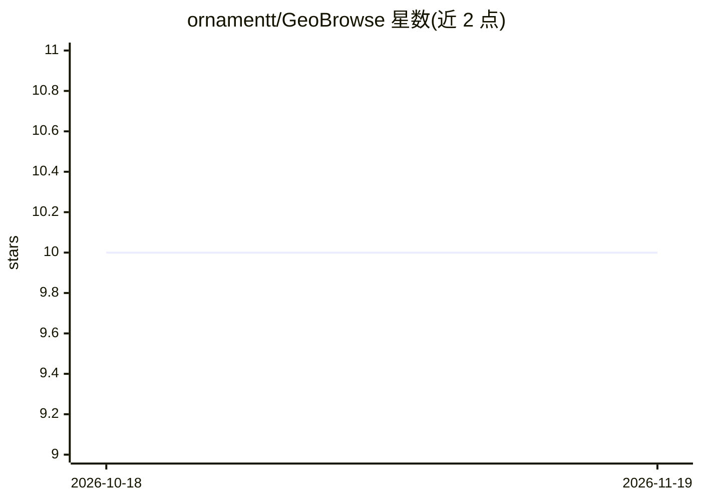

# ornamentt/GeoBrowse

⭐ 10 · Python · MIT · 推送 2026-06-15 · [GitHub](https://github.com/ornamentt/GeoBrowse) · [官网](https://huggingface.co/datasets/Ornamentt/GeoBrowse) · 组织维护

**面向开发者的多模态 web agent 地理定位评测基准**

GeoBrowse 是一个面向地理定位推理任务的基准，附带开源系统：核心推理组件 GATE 协调网页浏览、视觉推理、搜索、文件/文档工具与评估辅助。它读取 JSONL 格式任务数据集，通过 gpt:* 模型名或 OpenAI 兼容 HTTP 端点调用 LLM/VLM 后端，启动本地 Playwright 浏览器服务执行网页任务，保存逐任务会话轨迹与评测结果，并附带基线评测脚本与 Docker 容器化运行方式。细节依赖其 arXiv 论文。

## 筛选速览

| 维度 | 判定 | 备注 |
|---|---|---|
| AI 角色 | `ai-ecosystem` | LLM/agent 周边工具 |
| 许可风险 | `permissive` | MIT |
| 部署形态 | `self-host` | docker 或自建部署 |
| 模型依赖 | local-ok | 支持本地模型 |
| 硬件要求 | — | 无带数字的原话,不猜 |
| 安装摩擦 | `low` | 无编译、无系统依赖或容器化 |
| 成熟度 | — | 结构信号不足 |

## 能力要点

- JSONL 任务数据集驱动的 agent 运行器与会话轨迹输出
- GATE 框架协调浏览、视觉推理、搜索与文档工具
- 支持 gpt:*、Azure OpenAI 与 OpenAI 兼容 vLLM 端点
- 附带基线评测脚本与发布就绪校验器

## 适用场景

- 对多模态 web agent 做地理定位任务基准评测
- 用自托管 vLLM 端点替换默认模型后端复现评测
- 以 Docker 容器隔离运行模型生成的代码

## 场景标签

`模型评测` `多模态` · 领域:评测与运维

## 证据(README 行号)

> L3: GeoBrowse is a benchmark with open-source system for geography-oriented web browsing and multimodal task solving. It
> L11: For more details about the benchmark, data construction pipeline, and evaluation protocol, please refer to the pape
> L21: - Includes baseline evaluation scripts and a release-readiness verifier.

## 星数曲线

2026-10-18 10 → 2026-11-19 10（+0）

---
*卡片 v1 · prompt 1.4 · 生成 2026-11-19 · 置信度 high · 依据 README sha `d71f5b532e04` · [字段定义](../../DATASET.md)*
