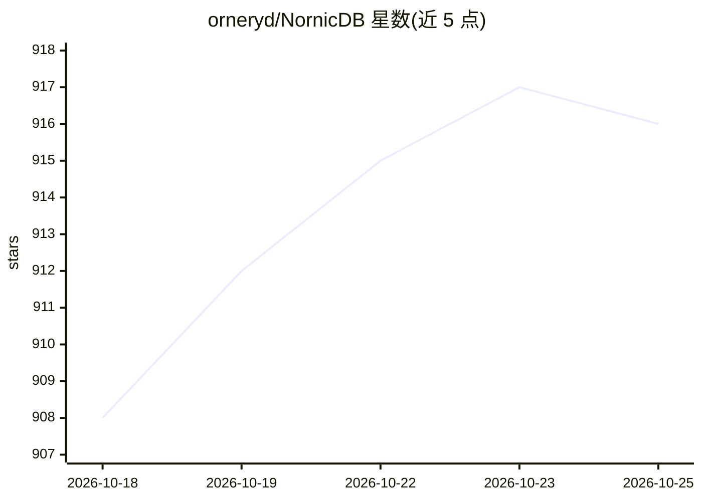

# orneryd/NornicDB

⭐ 916 · Go · MIT · 推送 2026-10-25 · [GitHub](https://github.com/orneryd/NornicDB) · 个人维护

**Neo4j 兼容的图+向量+时序 MVCC 数据库，面向 Agent 记忆与 Graph-RAG**

Go 编写的图数据库，单一引擎内提供图遍历、HNSW 向量检索、混合检索（BM25 融合+可选 BGE-M3 重排）、MVCC 历史读与审计语义。通过 Bolt/Cypher 兼容 Neo4j 驱动，保留 Qdrant gRPC 工作流，另暴露 REST/GraphQL/gRPC。面向知识系统、Agent 记忆、Graph-RAG 与审计型真相存储等场景，支持 CPU/CUDA/Metal/Vulkan 多架构，提供含内嵌 bge-m3 模型的 Docker 镜像与 BYOM 部署。README 含与 Neo4j/Qdrant 的对比基准及 UCLouvain CPS 研究用例。

## 筛选速览

| 维度 | 判定 | 备注 |
|---|---|---|
| AI 角色 | `ai-ecosystem` | LLM/agent 周边工具 |
| 许可风险 | `permissive` | MIT |
| 部署形态 | `desktop` | 安装包/桌面程序 |
| 模型依赖 | — | README 未给出锁定关系 |
| 硬件要求 | `cpu-ok` | |
| 安装摩擦 | `low` | 无编译、无系统依赖或容器化 |
| 成熟度 | — | 结构信号不足 |

## 能力要点

- 单引擎内图遍历+向量检索+混合检索（BM25 融合+可选 BGE-M3 重排）
- Bolt/Cypher 与 Neo4j 驱动兼容，保留 Qdrant gRPC 工作流
- MVCC 快照隔离、as-of 历史读与 canonical graph ledger 审计建模
- CPU/CUDA/Metal/Vulkan 多架构镜像，支持 BYOM 与 headless 部署

## 适用场景

- 用单库替代 Neo4j+Qdrant+嵌入管线跑 Graph-RAG
- Agent 记忆系统需要时间事实、记忆衰减与可回放历史
- 需要审计与历史版本读的规范知识存储
- 现有 Neo4j 应用零改动迁移并获得向量能力

## 场景标签

`向量数据库` · 领域:知识与检索

## 证据(README 行号)

> L54: It is built for knowledge systems, agent memory, Graph-RAG, and canonical truth stores where semantic search is onl
> L59: - **Built for AI-native workloads**: vector search, memory decay, and auto-relationships are first-class features.
> L69: - **Agent and Graph-RAG systems**: replacing a Neo4j + Qdrant + embeddings stack with a single deployment for task 

## 星数曲线

2026-10-18 908 → 2026-10-25 916（+8）

---
*卡片 v1 · prompt 1.4 · 生成 2026-10-21 · 置信度 high · 依据 README sha `5c251b41ae94` · [字段定义](../../DATASET.md)*
