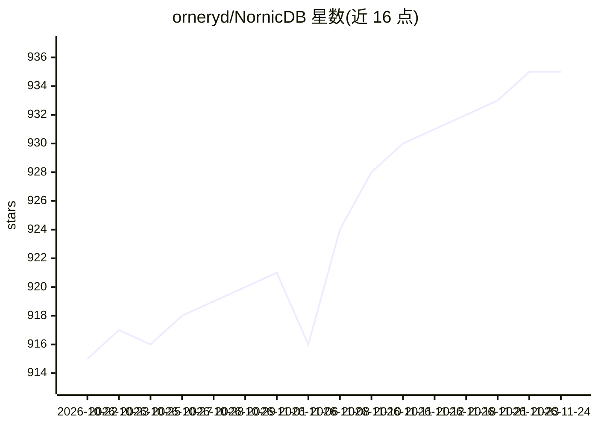

# orneryd/NornicDB

⭐ 935 · Go · MIT · 推送 2026-11-22 · [GitHub](https://github.com/orneryd/NornicDB) · 个人维护

**兼容 Neo4j 协议的图+向量数据库，供开发者运行图检索与 AI 记忆**

用 Go 编写的图数据库，在同一存储中提供 Cypher 查询、图遍历、向量搜索与基于 MVCC 的历史读取，支持 Bolt 与 HTTP 接口，可嵌入 Go 应用。与 Neo4j Bolt/Cypher 及 qdrant gRPC 协议兼容，宣称可无缝切换；提供托管 embedding、重排序+LLM、GPU 加速等面向 AI 场景的功能，包含 MCP server 相关能力。通过 Homebrew、Docker 镜像（CPU/CUDA/Vulkan）、macOS .pkg 安装包或源码构建部署。

## 筛选速览

| 维度 | 判定 | 备注 |
|---|---|---|
| AI 角色 | `ai-enhanced` | 去掉 AI 部分产品仍成立 |
| 许可风险 | `permissive` | MIT |
| 部署形态 | `desktop` | 安装包/桌面程序 |
| 模型依赖 | — | README 未给出锁定关系 |
| 硬件要求 | — | 无带数字的原话,不猜 |
| 安装摩擦 | `medium` | 含编译或系统依赖之一 |
| 成熟度 | — | 结构信号不足 |

## 能力要点

- 同时提供图遍历、向量搜索与全文检索的混合查询
- MVCC 历史读取与事务、持久化
- 兼容 Neo4j Bolt/Cypher 与 qdrant gRPC 协议
- 多架构支持：CPU/CUDA/Metal/Vulkan

## 适用场景

- 为 RAG 应用提供图+向量混合检索存储
- 从 Neo4j 或 qdrant 迁移而少改动代码
- 作为 agent 的记忆存储后端
- 需要历史状态查询的图数据建模

## 场景标签

`向量数据库` `知识图谱` · 领域:知识与检索

## 证据(README 行号)

> L5:  Graph, vector, and historical truth in one database
> L6:  Neo4j-compatible • Hybrid graph + vector retrieval • Historical reads via MVCC
> L65: NornicDB is a graph database that combines Cypher queries, graph traversal, vector search, and historical reads. It

## 星数曲线

2026-10-22 915 → 2026-11-24 935（+20）

---
*卡片 v1 · prompt 1.4 · 生成 2026-11-24 · 置信度 high · 依据 README sha `46f7476db518` · [字段定义](../../DATASET.md)*
