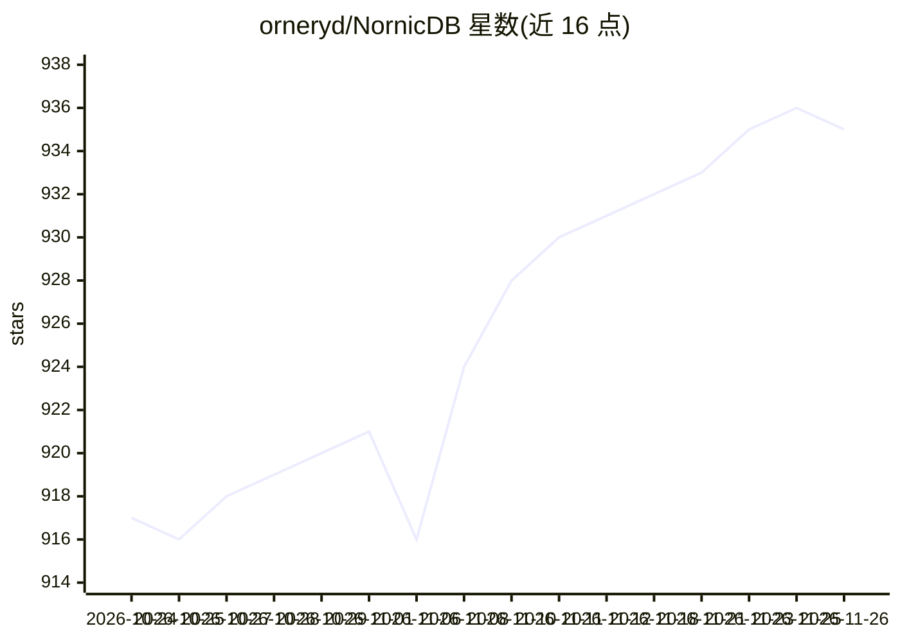

# orneryd/NornicDB

⭐ 935 · Go · MIT · 推送 2026-11-25 · [GitHub](https://github.com/orneryd/NornicDB) · 个人维护

**兼容 Neo4j/Qdrant 的图+向量混合数据库，开发者可无缝替换**

NornicDB 是一个将图查询、向量检索与历史读取结合的图数据库，使用 Cypher 查询语言与 Bolt/HTTP 接口，支持 Neo4j Bolt/Cypher 与 qdrant gRPC 协议迁移，可嵌入 Go 应用。特性包括 MVCC 历史读取、子毫秒 HNSW 搜索、模式管理、托管嵌入、重排序+LLM、MCP server，支持 CPU/CUDA/Metal/Vulkan 多架构部署。通过 Homebrew、Docker、macOS 安装包或源码构建安装，MIT 许可。

## 筛选速览

| 维度 | 判定 | 备注 |
|---|---|---|
| AI 角色 | `ai-enhanced` | 去掉 AI 部分产品仍成立 |
| 许可风险 | `permissive` | MIT |
| 部署形态 | `desktop` | 安装包/桌面程序 |
| 模型依赖 | — | README 未给出锁定关系 |
| 硬件要求 | — | 无带数字的原话,不猜 |
| 安装摩擦 | `medium` | 含编译或系统依赖之一 |
| 成熟度 | — | 结构信号不足 |

## 能力要点

- 兼容 Neo4j Bolt/Cypher 与 qdrant gRPC 协议，可零改动切换
- MVCC 历史读取与时间旅行查询
- 子毫秒 HNSW 向量搜索、图遍历与写入
- 支持 CPU、CUDA、Metal、Vulkan 多架构与 GPU 加速

## 适用场景

- 从 Neo4j 或 Qdrant 迁移而不改动客户端代码
- 为 AI Agent 提供图+向量混合检索的持久记忆
- 需要历史状态读取与时间点查询的数据建模
- 嵌入 Go 应用内运行的本地图数据库

## 场景标签

`向量数据库` · 领域:知识与检索

## 证据(README 行号)

> L65: NornicDB is a graph database that combines Cypher queries, graph traversal, vector search, and historical reads. It
> L69: - Query connected data using Cypher and compatible Bolt drivers.
> L83: - Vector search, memory policies, and agent integration.

## 星数曲线

2026-10-24 917 → 2026-11-26 935（+18）

---
*卡片 v1 · prompt 1.4 · 生成 2026-11-25 · 置信度 mid · 依据 README sha `8e81f3864370` · [字段定义](../../DATASET.md)*
