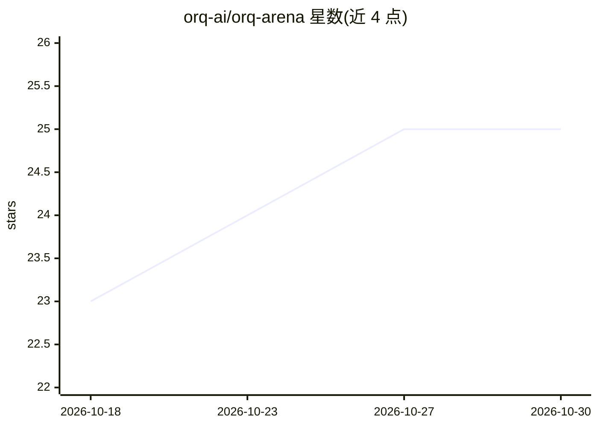

# orq-ai/orq-arena

⭐ 25 · Python · MIT · 推送 2026-10-29 · [GitHub](https://github.com/orq-ai/orq-arena) · [官网](https://orq-ai.github.io/orq-arena/) · 组织维护

**面向自有提示集的 LLM 头对头竞技场评测工具**

由 Orq.ai 团队维护的 LLM 评测 CLI：一条命令对模型池运行循环赛，模型评审团盲评每对回答（默认双向判罚），输出 Bradley-Terry/ELO 排行榜、95% 置信区间、质量-成本图与 HTML 报告；原始对战数据落盘 battles.jsonl，支持换评审团重判与人工抽检标注。模型调用经 orq.ai 路由网关，需 ORQ_API_KEY；自带的 30 条提示集仅定位为冒烟测试。安装依赖 Python>=3.10 与 uv，通过 git clone 后 uv tool install 完成。

## 筛选速览

| 维度 | 判定 | 备注 |
|---|---|---|
| AI 角色 | `ai-ecosystem` | LLM/agent 周边工具 |
| 许可风险 | `permissive` | MIT |
| 部署形态 | `None` |  |
| 模型依赖 | — | README 未给出锁定关系 |
| 硬件要求 | — | 无带数字的原话,不猜 |
| 安装摩擦 | `low` | 无编译、无系统依赖或容器化 |
| 成熟度 | — | 结构信号不足 |

## 能力要点

- 循环赛制 + 双向盲评的模型评审团与位置偏差控制（换序改判的评审被剔除）
- Bradley-Terry/ELO 排名带 bootstrap 95% 置信区间，含质量-成本对照图
- 单文件自包含 HTML 报告，可无模型调用重新生成
- battles.jsonl 输出成对偏好数据，支持 rejudge 换评审团与 annotate 人工标注

## 适用场景

- 在自己的业务提示上挑选产品默认模型
- 新模型发布后重排模型池并核对成本
- 生成成对偏好数据供后续分析
- 检验开启 thinking 对自身任务是否有影响

## 场景标签

`模型评测` · 领域:评测与运维

## 证据(README 行号)

> L13: One command runs a round-robin tournament over your models. A panel of judges compares every pair of answers blind,
> L27: Models are called through the orq.ai router gateway, so one API key covers every provider; judging is evaluatorq, o
> L31: - Pick a default model for a product on **your own prompts**, not a public leaderboard's

## 星数曲线

2026-10-18 23 → 2026-10-30 25（+2）

---
*卡片 v1 · prompt 1.4 · 生成 2026-10-27 · 置信度 high · 依据 README sha `5cc76d1cad7a` · [字段定义](../../DATASET.md)*
