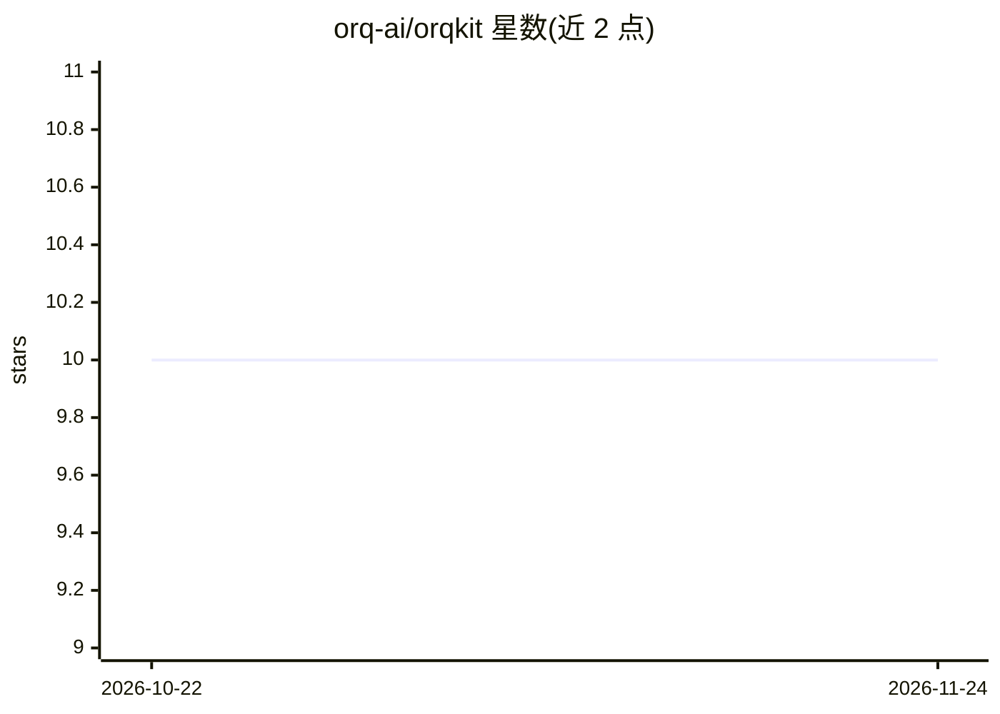

# orq-ai/orqkit

⭐ 10 · TypeScript · MIT · 推送 2026-11-23 · [GitHub](https://github.com/orq-ai/orqkit) · [官网](https://orq.ai/) · 组织维护

**为开发者提供运行 AI 评估流水线的工具集**

Orq AI 开源的 monorepo，包含用于构建 AI 评估流水线的工具：@orq-ai/evaluatorq 评估框架（Effect 架构、并行评估、内置重试）、可复用 evaluators、CLI、Vercel AI SDK provider、n8n 社区节点及依赖注入容器。评估结果可通过 OpenTelemetry 追踪；连接 orq.ai 平台时支持数据集管理与结果跟踪，未连接时可将结果发到自有看板。evaluator 返回 pass:false 时进程以退出码 1 结束，可集成到 CI/CD。Python 版 evaluatorq 已迁出至独立仓库。

## 筛选速览

| 维度 | 判定 | 备注 |
|---|---|---|
| AI 角色 | `ai-ecosystem` | LLM/agent 周边工具 |
| 许可风险 | `permissive` | MIT |
| 部署形态 | `library` | 以包/库形式分发 |
| 模型依赖 | — | README 未给出锁定关系 |
| 硬件要求 | — | 无带数字的原话,不猜 |
| 安装摩擦 | `low` | 无编译、无系统依赖或容器化 |
| 成熟度 | — | 结构信号不足 |

## 能力要点

- 并行评估框架，内置重试逻辑，本地与 CI/CD 使用同一套评估
- 内置 OpenTelemetry 追踪，支持自定义 OTEL 端点
- evaluator pass/fail 结果可触发非零退出码以接入 CI/CD
- 提供 Vercel AI SDK provider 与 n8n 社区节点集成

## 适用场景

- 为 LLM 应用建立跨多 prompt 和多模型的批量评估
- 在模型更新后运行回归测试防止功能退化
- 把评估作为单元测试框架验证模型变更
- 将评估流程纳入 CI/CD 流水线

## 场景标签

`模型评测` · 领域:评测与运维

## 证据(README 行号)

> L3: Tools from Orq AI for building robust AI evaluation pipelines, online or offline. The monorepo contains utilities fo
> L14: - **Evaluate at Scale** - Run parallel evaluations across datasets with built-in retry logic
> L18: - **OpenTelemetry Support** - Built-in tracing for observability into your evaluation runs

## 星数曲线

2026-10-22 10 → 2026-11-24 10（+0）

---
*卡片 v1 · prompt 1.4 · 生成 2026-11-19 · 置信度 mid · 依据 README sha `a5689e83398e` · [字段定义](../../DATASET.md)*
