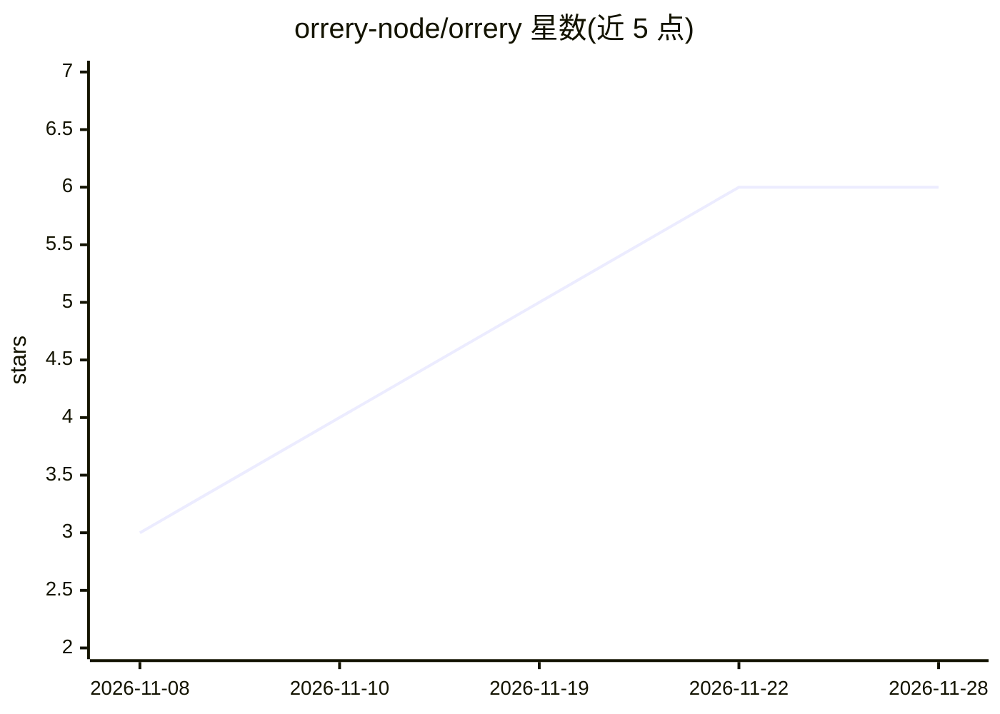

# orrery-node/orrery

⭐ 6 · TypeScript · MIT · 推送 2026-11-27 · [GitHub](https://github.com/orrery-node/orrery) · [官网](https://orrerynode.com) · 组织维护

**P2P AI 推理路由器：直连节点用 Solana 按答案付款，零抽成**

运行在本机的 OpenAI 兼容路由器（127.0.0.1:7171），把每个请求直接发给任何人的机器上运行的 provider 节点，用 Solana 支付通道按签名后的累计总额结算，协议程序无手续费字段、无中间账户。支持 Chat Completions 与流式输出，按模型名后缀选路由（价格/速度/信誉/私有enclave），provider 失败自动降级到下一个。需 Node 22+、少量 USDC 与 SOL，钱包密钥存本机。

## 筛选速览

| 维度 | 判定 | 备注 |
|---|---|---|
| AI 角色 | `ai-ecosystem` | LLM/agent 周边工具 |
| 许可风险 | `permissive` | MIT |
| 部署形态 | `self-host` | docker 或自建部署 |
| 模型依赖 | local-ok | 支持本地模型 |
| 硬件要求 | — | 无带数字的原话,不猜 |
| 安装摩擦 | `low` | 无编译、无系统依赖或容器化 |
| 成熟度 | — | 结构信号不足 |

## 能力要点

- OpenAI 兼容本地路由器，Cursor/Continue/Aider/LangChain/Open WebUI 无改动接入
- Solana 支付通道结算：88 字节 ed25519 凭证，按答案签名累计总额，程序 0% 抽成
- 路由后缀 :cheap/:fast/:trusted/:private，失败 provider 15秒-5分钟冷却并降级
- 任何人可挂载 vLLM/SGLang/Ollama/llama.cpp 或自有 API 容量成为 provider

## 适用场景

- 不经中间网关直接向独立 provider 付费调用推理
- 给 Claude Code/Aider 等编程工具设置带预算的运行任务
- 按成本/延迟/信誉或硬件 enclave 隐私路由选择 provider

## 场景标签

`模型网关` · 领域:Agent 开发

## 证据(README 行号)

> L31: Orrery has three parts, and none of them is a server we run.
> L35: |**Router**|your computer, `127.0.0.1:7171`|serves the OpenAI API to your tools, picks a provider for every request
> L59:  Chat Completions, streaming or not, and <code>/v1/models</code> on localhost. Cursor, Continue, Aider, Open WebUI,

## 星数曲线

2026-11-08 3 → 2026-11-28 6（+3）

---
*卡片 v1 · prompt 1.4 · 生成 2026-11-21 · 置信度 mid · 依据 README sha `ef093db195f8` · [字段定义](../../DATASET.md)*
