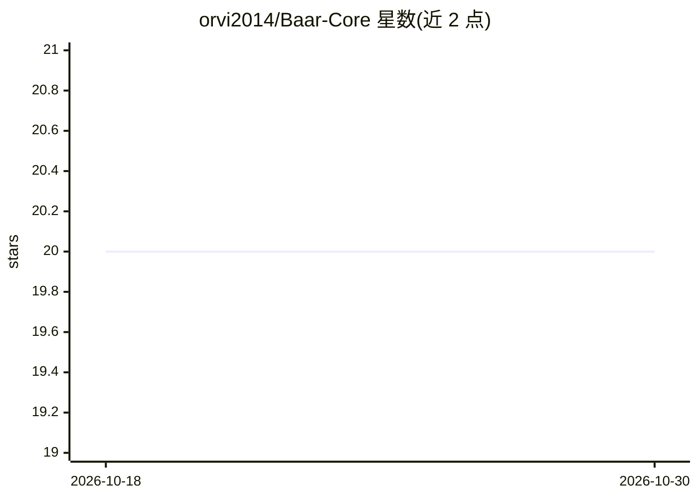

# orvi2014/Baar-Core

⭐ 20 · Python · MIT · 推送 2026-05-20 · [GitHub](https://github.com/orvi2014/Baar-Core) · [官网](https://noburn.dev) · 个人维护

**给 LLM agent 的预算路由治理库：调用前本地拦截超支请求**

以 Python 库（pip 安装）形式提供的 LLM 调用前置治理层：每次调用前在本地估算成本，预算不足即抛出异常，不发起网络请求；由廉价模型做语义复杂度评分，在大小模型间路由，预算吃紧时自动降级。通过 LiteLLM 支持 OpenAI、Anthropic、Groq、Ollama、OpenRouter 等提供商。提供 LangChain/LangGraph 集成、@baar_guard 工具调用限制、MCP server、OpenAI 兼容 HTTP server、基于 SQLite 的多租户每用户配额（WAL 模式、跨进程安全），以及 baar-bench 基准工具（mock/live 两种模式）。

## 筛选速览

| 维度 | 判定 | 备注 |
|---|---|---|
| AI 角色 | `ai-ecosystem` | LLM/agent 周边工具 |
| 许可风险 | `permissive` | MIT |
| 部署形态 | `library` | 以包/库形式分发 |
| 模型依赖 | local-ok | 支持本地模型 |
| 硬件要求 | — | 无带数字的原话,不猜 |
| 安装摩擦 | `medium` | 含编译或系统依赖之一 |
| 成熟度 | — | 结构信号不足 |

## 能力要点

- 调用前本地成本估算与硬预算熔断（零网络请求）
- 语义复杂度评分的大/小模型路由与预算压力自动降级
- LangChain/LangGraph/MCP/OpenAI 兼容 HTTP server 多种接入方式
- SQLite 多租户配额存储，WAL + 独占事务消除跨进程 TOCTOU 竞态

## 适用场景

- 生产环境自治 agent 设置花费硬上限，防止失控账单
- SaaS 按用户分配每用户 LLM 配额并持久化
- 缓解 OWASP LLM10:2025 Denial-of-Wallet 攻击
- Claude Code / Cursor 通过 MCP server 获得预算受控工具

## 场景标签

`模型网关` · 领域:Agent 开发

## 证据(README 行号)

> L3: Pre-flight runtime governance for LLM agents. Enforces hard execution limits locally — before requests reach the pro
> L61: 1. **Pre-flight check** — Estimates cost locally before any network call. Kills the request if it would overshoot.
> L74: Works with any LiteLLM-supported provider: OpenAI, Anthropic, Groq, Together, Ollama, OpenRouter, Azure, and more.

## 星数曲线

2026-10-18 20 → 2026-10-30 20（+0）

---
*卡片 v1 · prompt 1.4 · 生成 2026-10-28 · 置信度 high · 依据 README sha `d0dbbc52c727` · [字段定义](../../DATASET.md)*
