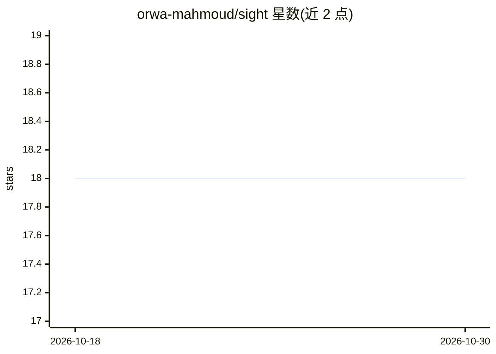

# orwa-mahmoud/sight

⭐ 18 · Python · MIT · 推送 2026-07-28 · [GitHub](https://github.com/orwa-mahmoud/sight) · [官网](https://orwa-mahmoud.github.io/sight/) · 个人维护

**多租户 AI 前台：基于自有文档的 RAG 问答并支持人工升级**

面向企业/商家的多租户 AI 客服前台：租户上传 PDF/DOCX/Markdown/文本，经分块、嵌入后用混合检索（向量+BM25+RRF）生成带出处的回答；无法回答的问题进入 owner 收件箱由人工接管并经原渠道回复。支持 WhatsApp Cloud API、Telegram 与内置聊天仪表盘多渠道接入；基于 PostgreSQL 17 + pgvector 行级安全实现租户隔离，逐租户配置 LLM 密钥并记录 token 花费。当前限制：每用户仅绑定一个租户（无切换器）。

## 筛选速览

| 维度 | 判定 | 备注 |
|---|---|---|
| AI 角色 | `ai-native` | 本体是模型或模型工具 |
| 许可风险 | `permissive` | MIT |
| 部署形态 | `self-host` | docker 或自建部署 |
| 模型依赖 | — | README 未给出锁定关系 |
| 硬件要求 | — | 无带数字的原话,不猜 |
| 安装摩擦 | `low` | 无编译、无系统依赖或容器化 |
| 成熟度 | — | 结构信号不足 |

## 能力要点

- 混合检索 RAG（向量 + BM25 + RRF）并逐条引用来源文档
- 未答问题升级到 owner 收件箱，人工回复经原渠道转回
- WhatsApp/Telegram/内置聊天三渠道统一网关
- Postgres 行级安全 + 最小权限角色实现租户隔离

## 适用场景

- 把商家政策文档变成会引用出处的自动客服
- 客服答不上时自动转人工收件箱处理
- 多租户 SaaS 场景下隔离各自的文档与 LLM 密钥

## 场景标签

`RAG` `文档问答` `聊天机器人` · 领域:对话与助手

## 证据(README 行号)

> L28: - **RAG-grounded answers** — hybrid retrieval (vector + BM25 + RRF) over each
> L81: 5. **AI answers** using RAG over the tenant's documents.

## 星数曲线

2026-10-18 18 → 2026-10-30 18（+0）

---
*卡片 v1 · prompt 1.4 · 生成 2026-10-29 · 置信度 high · 依据 README sha `b8c37b4068cc` · [字段定义](../../DATASET.md)*
