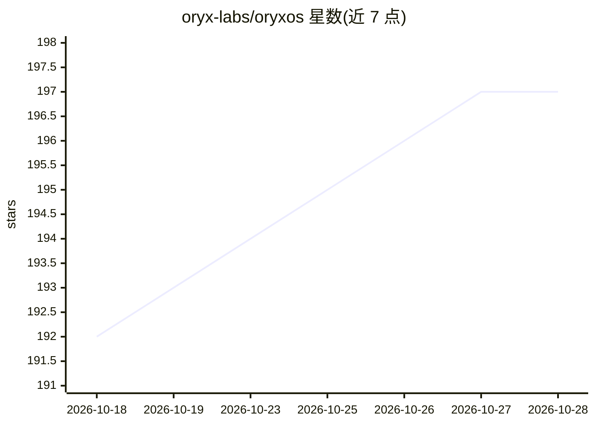

# oryx-labs/oryxos

⭐ 197 · Java · Apache-2.0 · 推送 2026-10-28 · [GitHub](https://github.com/oryx-labs/oryxos) · [官网](https://oryx-labs.github.io/oryxos/) · 组织维护

**面向企业的自托管分布式 AI Agent 操作系统**

用 Java 实现的自托管 Agent OS：以单个二进制/fat JAR 进程提供 REST API、Web 管理台、调度器与沙箱。Agent 以一个 Markdown 目录（AGENT.md）定义即可上线，内置自研 ReAct 循环、24 个内置工具、MCP 连接器、长期记忆、知识库混合检索、通知与 cron 调度。LLM 提供商存于 SQLite 注册表可运行时增删，支持本地推理；工具调用经白名单管控，所有调用写入审计表。需 Java 21 + Maven 构建，Windows 需在 WSL2 运行，另提供多架构 Docker 镜像。

## 筛选速览

| 维度 | 判定 | 备注 |
|---|---|---|
| AI 角色 | `ai-ecosystem` | LLM/agent 周边工具 |
| 许可风险 | `permissive` | Apache-2.0 |
| 部署形态 | `self-host` | docker 或自建部署 |
| 模型依赖 | local-ok | 支持本地模型 |
| 硬件要求 | — | 无带数字的原话,不猜 |
| 安装摩擦 | `low` | 无编译、无系统依赖或容器化 |
| 成熟度 | — | 结构信号不足 |

## 能力要点

- AGENT.md 目录定义 Agent，一句话可由 LLM 生成草稿
- 自实现 ReAct 循环，无外部框架依赖
- SQLite 动态 Provider 注册表，多提供商路由、支持本地推理
- 工具调用白名单管控与全量审计持久化
- 单二进制进程含 REST API、Vue 3 管理台、调度器与沙箱

## 适用场景

- 在企业自有基础设施上运行和管理多个 AI Agent
- 以自然语言一句话定义并部署新 Agent
- 通过 REST API 将 Agent 能力接入业务系统

## 场景标签

`Agent 框架` · 领域:Agent 开发

## 证据(README 行号)

> L10: **OryxOS is the self-hosted Agent OS for the enterprise.** Describe a task in one sentence of natural language — Or
> L33: **The bottleneck for reliable agents in production is not the model — it's the harness around it.** And an enterpri
> L40: |Provides|Text generation|Loop, tools + execution, context, memory, sandbox, audit, delivery|Lifecycle, channels, r

## 星数曲线

2026-10-18 192 → 2026-10-28 197（+5）

---
*卡片 v1 · prompt 1.4 · 生成 2026-10-23 · 置信度 high · 依据 README sha `758af2134a53` · [字段定义](../../DATASET.md)*
