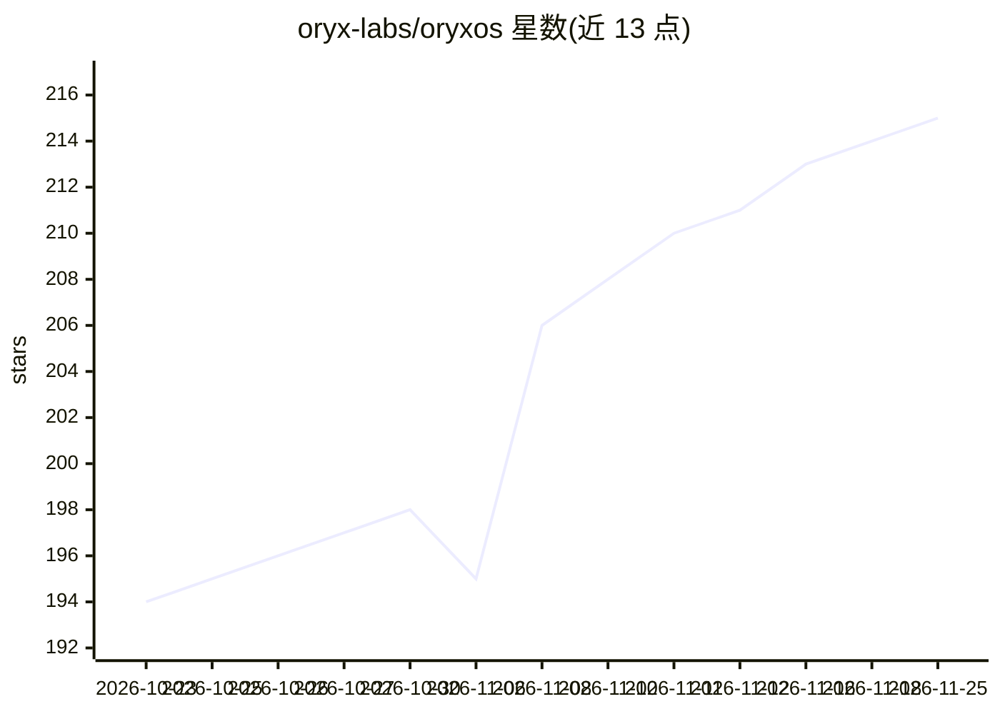

# oryx-labs/oryxos

⭐ 215 · Java · Apache-2.0 · 推送 2026-11-24 · [GitHub](https://github.com/oryx-labs/oryxos) · [官网](https://oryx-labs.github.io/oryxos/) · 组织维护 · 中文 README

**企业级自托管 Agent OS：统一构建、运行并治理 AI Agent 应用**

面向企业的开源自托管 Agent Harness OS：为 AI 应用提供共享运行时，覆盖 Agent 与任务生命周期（会话、记忆、状态、制品、证据）、模型路由与成本优化、知识库与上下文组装、Tools/MCP/企业系统集成。核心机制是治理嵌入执行路径：身份、授权、策略、审批、沙箱、审计、成本归属随任务执行。Java 构建（mvn），默认内置 mock Provider，无需 LLM API key 即可启动，管理界面位于 localhost:8080。

## 筛选速览

| 维度 | 判定 | 备注 |
|---|---|---|
| AI 角色 | `ai-ecosystem` | LLM/agent 周边工具 |
| 许可风险 | `permissive` | Apache-2.0 |
| 部署形态 | `None` |  |
| 模型依赖 | — | README 未给出锁定关系 |
| 硬件要求 | — | 无带数字的原话,不猜 |
| 安装摩擦 | `low` | 无编译、无系统依赖或容器化 |
| 成熟度 | — | 结构信号不足 |

## 能力要点

- Agent 与任务运行时：一致的生命周期、受控环境、持久化工作
- 治理嵌入执行路径：授权、策略、审批、沙箱、审计、成本归属
- 模型按质量/延迟/成本/数据边界路由
- MCP 原生，Tools、Skills、渠道与自定义扩展

## 适用场景

- 构建研发自动化、知识支持、工单协作、运维诊断等领域 AI 应用
- 企业统一治理与审计所有 Agent 动作
- 按任务需求路由模型并做成本归因
- 自托管部署企业内部 AI 应用平台

## 场景标签

`Agent 框架` `模型网关` · 领域:Agent 开发

## 证据(README 行号)

> L12: **OryxOS is an open-source, self-hosted Agent Harness OS for enterprise AI applications.** It lets enterprises run 
> L20: Its core principle is simple: applications can freely compose capabilities, but they cannot bypass governance. Ever
> L41: |**Governance Runtime**|Identity, authorization, policy, approval, sandbox boundaries, and audit are part of the ac

## 星数曲线

2026-10-23 194 → 2026-11-25 215（+21）

---
*卡片 v1 · prompt 1.4 · 生成 2026-11-25 · 置信度 high · 依据 README sha `56171c9e528c` · [字段定义](../../DATASET.md)*
