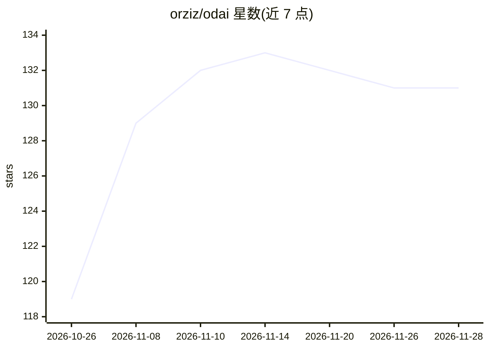

# orziz/odai

⭐ 131 · JavaScript · MIT · 推送 2026-11-26 · [GitHub](https://github.com/orziz/odai) · 个人维护 · 中文 README

**AI agent 通用任务治理框架：治理执行到可验证交付**

面向 AI agent 的治理框架，以技能（skill）形式嵌入执行流程：对齐真实目标、事实、假设、授权、风险与验收标准，按任务复杂度自适应调整处理深度，要求从文件、命令、日志、测试等先行验证，避免未经验证的声明。核心以 /odai 调用，可将可选编排拆为独立技能；另提供面向 DeepSeek Harness 的 DSH 插件与 Agent 两个 npm 包，包含控制中心、职责预设与主机能力路由映射，治理可在不启用编排的情况下工作。

## 筛选速览

| 维度 | 判定 | 备注 |
|---|---|---|
| AI 角色 | `ai-ecosystem` | LLM/agent 周边工具 |
| 许可风险 | `permissive` | MIT |
| 部署形态 | `library` | 以包/库形式分发 |
| 模型依赖 | locked-api |  |
| 硬件要求 | — | 无带数字的原话,不猜 |
| 安装摩擦 | `low` | 无编译、无系统依赖或容器化 |
| 成熟度 | — | 结构信号不足 |

## 能力要点

- /odai 按任务歧义、复杂度与风险自适应增减治理深度
- 要求从文件、命令、日志、测试或项目上下文先行验证，防止虚假声明
- 主机能力路由：一次性确认职责与模型映射后持久化到项目
- 提供 odai-dsh-plugin 与 odai-dsh-agent 两个 DSH 集成包及中文控制中心

## 适用场景

- 让 agent 在自主执行任务时守住授权与风险边界
- 为复杂任务规划职责分工并调度多个模型/子 agent
- 要求任务结果经过验证后才标记为可交付

## 场景标签

`Agent 框架` `多智能体` · 领域:Agent 开发

## 证据(README 行号)

> L7: `odai` is a governance-powered general task-execution framework for AI agents.
> L57: npx skills add https://github.com/orziz/odai --skill odai
> L81: ### DeepSeek Harness packages

## 星数曲线

2026-10-26 119 → 2026-11-28 131（+12）

---
*卡片 v1 · prompt 1.4 · 生成 2026-11-28 · 置信度 mid · 依据 README sha `3b10de4692f8` · [字段定义](../../DATASET.md)*
