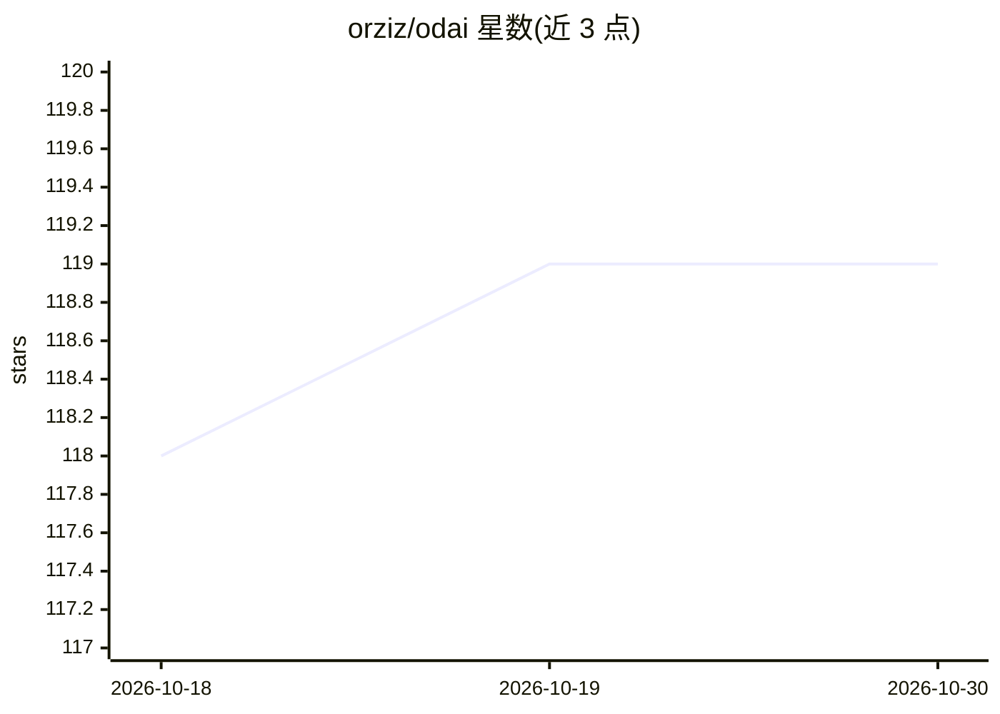

# orziz/odai

⭐ 119 · JavaScript · MIT · 推送 2026-10-29 · [GitHub](https://github.com/orziz/odai) · 个人维护 · 中文 README

**AI agent 通用任务治理框架：对齐目标、规划调度、验收交付**

面向 AI agent 的治理型通用任务执行框架：以技能（skill）形式安装，通过 /odai 调用，将治理嵌入执行过程——对齐真实目标、事实、授权与验收标准，选择最短充分路径，组合能力执行并验证到可交付状态。治理深度随任务复杂度与风险自动伸缩，轻量任务保持轻量。支持主机能力路由（责任到模型的映射持久化），提供 DeepSeek Harness 的两个 npm 集成包（plugin 与 agent），含中文控制中心、输出三模式契约与本地关怀偏好记录等机制。

## 筛选速览

| 维度 | 判定 | 备注 |
|---|---|---|
| AI 角色 | `ai-ecosystem` | LLM/agent 周边工具 |
| 许可风险 | `permissive` | MIT |
| 部署形态 | `library` | 以包/库形式分发 |
| 模型依赖 | locked-api |  |
| 硬件要求 | — | 无带数字的原话,不猜 |
| 安装摩擦 | `low` | 无编译、无系统依赖或容器化 |
| 成熟度 | — | 结构信号不足 |

## 能力要点

- 治理深度随任务复杂度与风险自动伸缩，轻量任务保持轻量
- 主机能力路由：责任-模型映射一次确认后持久化
- DeepSeek Harness 提供 plugin 与 agent 两个独立 npm 集成包
- 控制器持有目标、全局状态、纠错循环与最终交付的持久任务线程

## 适用场景

- 让 agent 自主执行任务但避免未经证实的断言与越权行为
- 在多模型主机上按责任（研究/规划/评审/实现）路由能力
- 为 DeepSeek Harness 全部 agent 预设统一应用治理

## 场景标签

`编码 Agent` `Agent 框架` · 领域:Agent 开发

## 证据(README 行号)

> L7: `odai` is a governance-powered general task-execution framework for AI agents.
> L9: It embeds governance into execution: align the real objective, facts, assumptions, authorization, risks, and accepta
> L81: ### DeepSeek Harness packages

## 星数曲线

2026-10-18 118 → 2026-10-30 119（+1）

---
*卡片 v1 · prompt 1.4 · 生成 2026-10-23 · 置信度 high · 依据 README sha `333ad6ed5289` · [字段定义](../../DATASET.md)*
