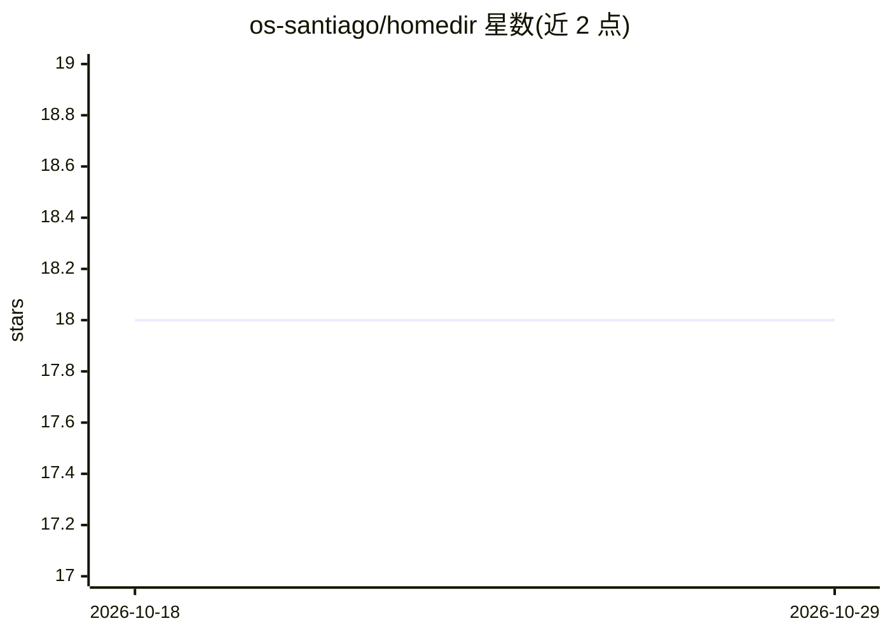

# os-santiago/homedir

⭐ 18 · Java · Apache-2.0 · 推送 2026-10-06 · [GitHub](https://github.com/os-santiago/homedir) · [官网](https://homedir.opensourcesantiago.io/) · 组织维护

**面向 DevRel/开源社区的 Quarkus 平台：活动、项目、CFP 与贡献者整合**

基于 Quarkus 的社区平台，将 Community Picks、Events、Projects、CFP 工作流、GitHub Trending 仓库与贡献者身份集成（GitHub/Discord/Google 登录）整合为一个产品。仓库按模块组织（主应用、文档、治理配置、部署脚本、E2E 测试等），部署提供 Quay 公共镜像与源码构建两种方式；README 未展示平台内直接面向用户的 AI 功能，AI 相关信息仅体现在项目描述（以 AI Agents/AI SDLC 方式开发）与 CodeRabbit PR 审查徽章中。包含 Bounty Hunters 贡献积分体系与公开 API 端点。

## 筛选速览

| 维度 | 判定 | 备注 |
|---|---|---|
| AI 角色 | `ai-enhanced` | 去掉 AI 部分产品仍成立 |
| 许可风险 | `permissive` | Apache-2.0 |
| 部署形态 | `self-host` | docker 或自建部署 |
| 模型依赖 | — | README 未给出锁定关系 |
| 硬件要求 | — | 无带数字的原话,不猜 |
| 安装摩擦 | `low` | 无编译、无系统依赖或容器化 |
| 成熟度 | — | 结构信号不足 |

## 能力要点

- Community Picks、Events、Projects、CFP 工作流与 GitHub Trending 整合于单一产品
- GitHub/Discord/Google 登录的贡献者身份集成
- 提供 Quay 公共镜像、开发容器与源码构建三种运行途径
- Bounty Hunters 贡献积分体系含公开 API 端点

## 适用场景

- 社区运营者集中管理活动、项目与 CFP 流程
- 开源社区展示 GitHub Trending 与贡献者身份
- 组织通过积分体系激励志愿贡献

## 场景标签

 · 领域:开发者社区平台

## 证据(README 行号)

> L25: Homedir is a Quarkus-based community platform for DevRel/Open Source initiatives, combining Community Picks, Events
> L21:  <a href="https://coderabbit.ai" target="_blank">

## 星数曲线

2026-10-18 18 → 2026-10-29 18（+0）

---
*卡片 v1 · prompt 1.4 · 生成 2026-10-29 · 置信度 mid · 依据 README sha `69e7c6f56de4` · [字段定义](../../DATASET.md)*
