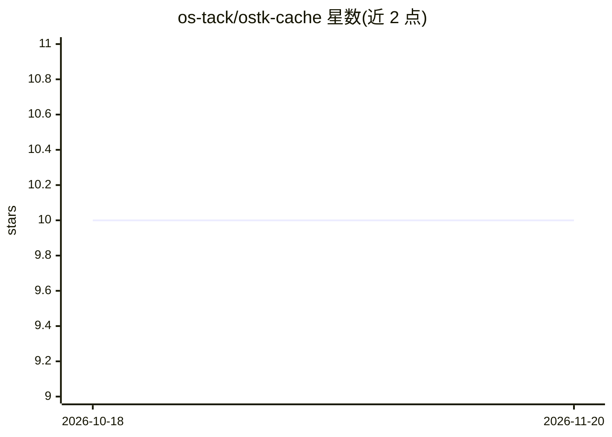

# os-tack/ostk-cache

⭐ 10 · Rust · Apache-2.0 · 推送 2026-06-12 · [GitHub](https://github.com/os-tack/ostk-cache) · [官网](https://ostk.ai/docs/ostk-cache/) · 组织维护

**面向 LLM 代理的提示缓存代理，提升缓存命中率**

本地运行的反向代理，拦截 Anthropic /v1/messages 请求并改写请求体：将系统提示、工具定义等长生命周期内容锚定到稳定字节边界以命中 Anthropic 提示缓存，另经 GPT 适配器为 /v1/responses 注入 OpenAI 缓存路由参数。支持四种改写模式、32MB 软上限分级裁减管道、每轮 ledger 记账与 A/B 统计工具。以预编译二进制分发（Linux/macOS/Windows），也可 Rust 源码构建。面向使用 Claude Code、Codex、Cursor 等可设 base URL 的代理开发者。

## 筛选速览

| 维度 | 判定 | 备注 |
|---|---|---|
| AI 角色 | `ai-ecosystem` | LLM/agent 周边工具 |
| 许可风险 | `permissive` | Apache-2.0 |
| 部署形态 | `desktop` | 安装包/桌面程序 |
| 模型依赖 | locked-api |  |
| 硬件要求 | — | 无带数字的原话,不猜 |
| 安装摩擦 | `medium` | 含编译或系统依赖之一 |
| 成熟度 | — | 结构信号不足 |

## 能力要点

- 四种改写模式（passthrough/mutate/rebuild/rebuild-kernel）可选
- 软上限四级裁减管道（工具结果弹出、配对修剪、工具定义裁剪、413）
- ledger 记账与 ostk-cache-stats 会话级 JSON/CSV 统计
- Claude Code 生命周期 hooks 安装器（SessionStart/PreToolUse 等）

## 适用场景

- 代理 Claude Code/Cursor 流量以提高提示缓存命中率
- 请求接近 Anthropic 32MB 上限时做分级裁减
- 对不同缓存模式做 A/B 对比分析
- 记录并审计代理请求的线缆体（--capture-http）

## 场景标签

 · 领域:LLM 基础设施/推理代理

## 证据(README 行号)

> L3: Drop-in **L1.5 caching proxy** for Anthropic `/v1/messages`, with an OpenAI GPT adapter for `/v1/responses`. The Ant
> L5: Works with **any surface that lets you set a provider base URL** — Claude Code, Codex, Cursor, custom MCP servers, i

## 星数曲线

2026-10-18 10 → 2026-11-20 10（+0）

---
*卡片 v1 · prompt 1.4 · 生成 2026-11-19 · 置信度 high · 依据 README sha `27c33e39cd04` · [字段定义](../../DATASET.md)*
