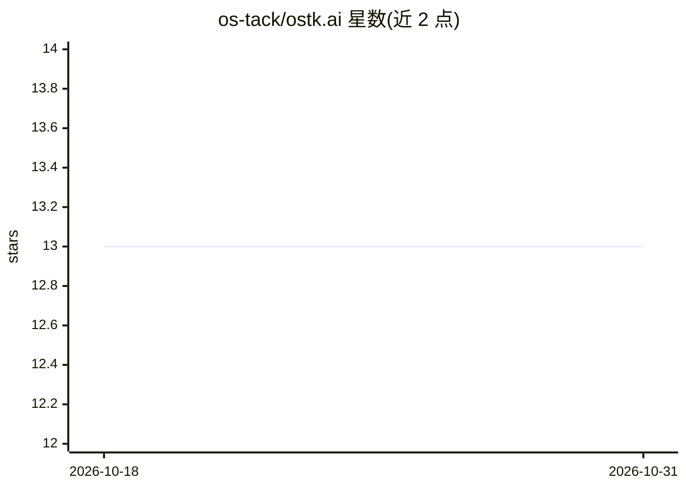

# os-tack/ostk.ai

⭐ 13 · Shell · NOASSERTION · 推送 2026-07-11 · [GitHub](https://github.com/os-tack/ostk.ai) · [官网](https://ostk.ai) · 组织维护

**面向 AI agent 的本地优先内核：通过文件系统协调多 agent**

ostk 是驻留在项目 .ostk/ 目录中的 POSIX 内核，用于协调 AI agent：通过文件系统而非消息协调，写入时拦截并处理冲突、审计与签名（每 epoch 用 DSSE 信封密封日志）。提供 135 个动词的 CLI 面、FUSE 挂载的 /ostk/ 虚拟文件系统、基于 GPG 的信任分级（T0–T3）、能力 pin（pin.caps）与崩溃恢复（audit 日志重放 + drain 快照再水化）。安装为 curl 脚本下载签名二进制，支持 macOS Apple Silicon、Linux x86_64/aarch64、Windows x86_64；运行需 bash、curl、gpg。AGPL-3.0。

## 筛选速览

| 维度 | 判定 | 备注 |
|---|---|---|
| AI 角色 | `ai-ecosystem` | LLM/agent 周边工具 |
| 许可风险 | `none` | NOASSERTION |
| 部署形态 | `None` |  |
| 模型依赖 | — | README 未给出锁定关系 |
| 硬件要求 | — | 无带数字的原话,不猜 |
| 安装摩擦 | `low` | 无编译、无系统依赖或容器化 |
| 成熟度 | — | 结构信号不足 |

## 能力要点

- 通过文件系统协调 agent，写入时拦截处理冲突/审计/签名
- FUSE 挂载 /ostk/ 虚拟文件系统查看内核状态
- GPG 身份链 + 信任分级 T0–T3 与能力 pin 治理
- 崩溃后重放 audit 日志重建 fleet，agent 级恢复策略

## 适用场景

- 在单一代码仓库内运行多个 AI agent 并协调其文件写入
- 对 agent 操作做签名审计与决策留痕
- 用 cat/ls/grep 直接检视 agent 系统的运行状态

## 场景标签

`多智能体` `Agent 框架` · 领域:Agent 开发

## 证据(README 行号)

> L3: **your os + tack** — a local-first operating system for AI agents.
> L5: ostk is a kernel that lives in your project's `.ostk/` directory. It coordinates AI agents through the filesystem in
> L28: - **Invisible coordination.** Agents see the tools they expect — shell, file:read, file:edit, web, task, recall. Th

## 星数曲线

2026-10-18 13 → 2026-10-31 13（+0）

---
*卡片 v1 · prompt 1.4 · 生成 2026-10-31 · 置信度 high · 依据 README sha `5cbe9e3d1fd5` · [字段定义](../../DATASET.md)*
