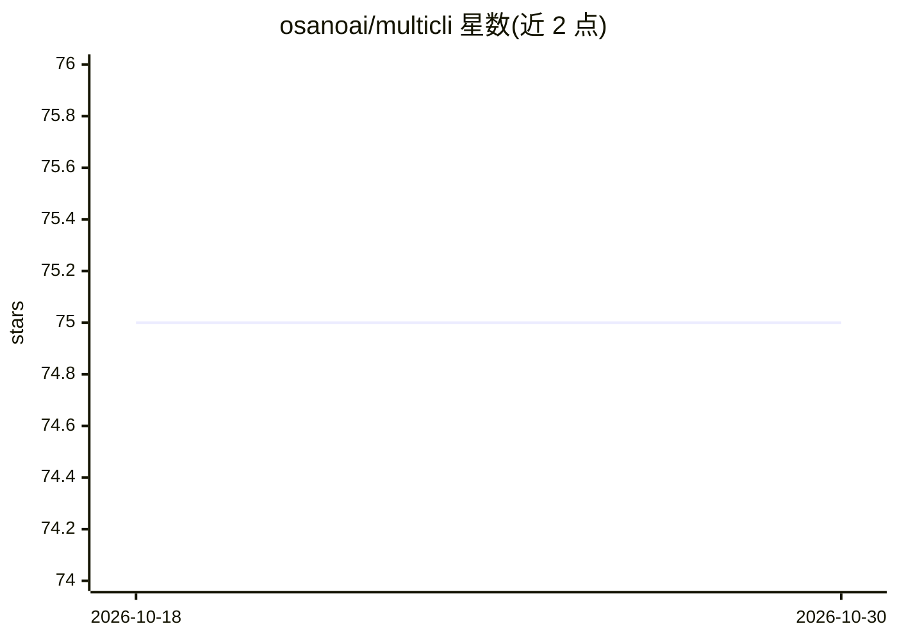

# osanoai/multicli

⭐ 75 · TypeScript · 推送 2026-09-14 · [GitHub](https://github.com/osanoai/multicli) · 组织维护

**让多个 AI 编码 CLI 互调的 MCP 桥接服务器**

一个基于 Model Context Protocol 的 MCP 服务器，使 Claude Code、Antigravity、Codex CLI、OpenCode 等 AI 编码客户端能够把彼此作为工具调用：每个客户端获得面向其他 CLI 的 Ask-*/List-* 工具（自身 CLI 被隐藏以避免自调用）。支持 stdio 与本地 HTTP（仅监听 127.0.0.1、Bearer token 认证）两种传输，提供 curl 一键安装脚本与 npm 全局安装，自动检测已装 CLI。要求 Node.js>=20 且至少一个目标 CLI。项目由 AI 参与编写并有 CI 每日自动更新模型目录。

## 筛选速览

| 维度 | 判定 | 备注 |
|---|---|---|
| AI 角色 | `ai-ecosystem` | LLM/agent 周边工具 |
| 许可风险 | `none` | — |
| 部署形态 | `library` | 以包/库形式分发 |
| 模型依赖 | locked-api |  |
| 硬件要求 | — | 无带数字的原话,不猜 |
| 安装摩擦 | `low` | 无编译、无系统依赖或容器化 |
| 成熟度 | — | 结构信号不足 |

## 能力要点

- Claude/Antigravity/Codex/OpenCode 之间通过 Ask-* 工具互相提问与委派
- stdio 与本地 HTTP 服务两种传输（仅 127.0.0.1，Bearer token 认证）
- 自动检测已安装 CLI，只暴露可用工具，隐藏自身 CLI 防自调用
- CI 每日比对模型目录并自动发布新版本（自维护机制）

## 适用场景

- 让 Claude Code 在编码时向 Codex 或 OpenCode 征求第二意见
- 跨多个 AI 编码 CLI 委派任务与代码审查
- 在单一 MCP 客户端内聚合多个 AI CLI 的模型能力

## 场景标签

`代码审查` · 领域:编码与开发

## 证据(README 行号)

> L10: **An MCP server that lets Claude, Antigravity, Codex, and OpenCode call each other as tools.**
> L33: Multi-CLI sits between your AI clients and bridges them via the Model Context Protocol. Install it once, and whiche
> L169: Multi-CLI supports both stdio and Streamable HTTP.

## 星数曲线

2026-10-18 75 → 2026-10-30 75（+0）

---
*卡片 v1 · prompt 1.4 · 生成 2026-10-24 · 置信度 high · 依据 README sha `f1e1cfd5f203` · [字段定义](../../DATASET.md)*
