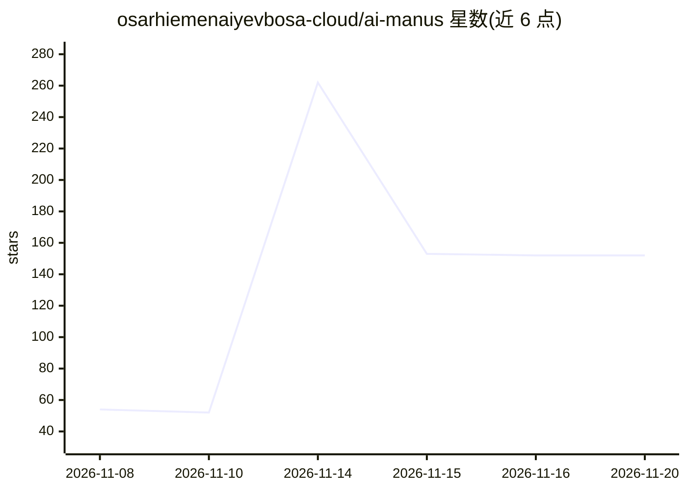

# osarhiemenaiyevbosa-cloud/ai-manus

⭐ 152 · Python · Apache-2.0 · 推送 2026-11-08 · [GitHub](https://github.com/osarhiemenaiyevbosa-cloud/ai-manus) · 个人维护

**面向个人用户的自主 AI Agent，代跑代码并控制浏览器完成多步任务**

Manus 是一个自主运行的通用 AI Agent，面向家庭、学习与轻量办公场景的用户：用户以自然语言描述需求，Agent 自行编写并执行脚本、打开网页、与页面元素交互、完成多步骤任务，可在后台持续运行并跨会话重复执行已学习的工作流。README 将其定位为非开发者也可使用的小型助手，而非企业平台。兼容性表列出最低双核 CPU 与 4 GB 内存；页面提供下载入口（Download Manus / PROMO2026），但未见具体安装命令、源码或依赖说明。

## 筛选速览

| 维度 | 判定 | 备注 |
|---|---|---|
| AI 角色 | `ai-native` | 本体是模型或模型工具 |
| 许可风险 | `permissive` | Apache-2.0 |
| 部署形态 | `None` |  |
| 模型依赖 | — | README 未给出锁定关系 |
| 硬件要求 | — | 无带数字的原话,不猜 |
| 安装摩擦 | `low` | 无编译、无系统依赖或容器化 |
| 成熟度 | — | 结构信号不足 |

## 能力要点

- 自主执行代码：Agent 自行编写并运行脚本完成任务
- 浏览器控制：导航网页、填写表单、抓取信息
- 多步骤任务与跨会话工作流重复执行
- 代码执行与浏览器操作可在同一任务流中衔接

## 适用场景

- 让学生整理研究笔记、跑小脚本而不必学编程
- 让 Agent 汇总多个网页信息、准备小型报告
- 把重复的日常小任务委托给后台 Agent 处理

## 场景标签

`浏览器自动化` `AI 助手` · 领域:效率与自动化

## 证据(README 行号)

> L10: - **Autonomous Code Execution:** Manus AI agent runs code on its own to complete tasks, so you can focus on decisio
> L18: Manus is an autonomous AI agent designed to run code and control a browser on your behalf. Instead of acting like a
> L22: Manus is not a heavy studio suite or a complex enterprise platform. It is a focused helper built for home, study, a

## 星数曲线

2026-11-08 54 → 2026-11-20 152（+98）

---
*卡片 v1 · prompt 1.4 · 生成 2026-11-17 · 置信度 mid · 依据 README sha `790070d90930` · [字段定义](../../DATASET.md)*
