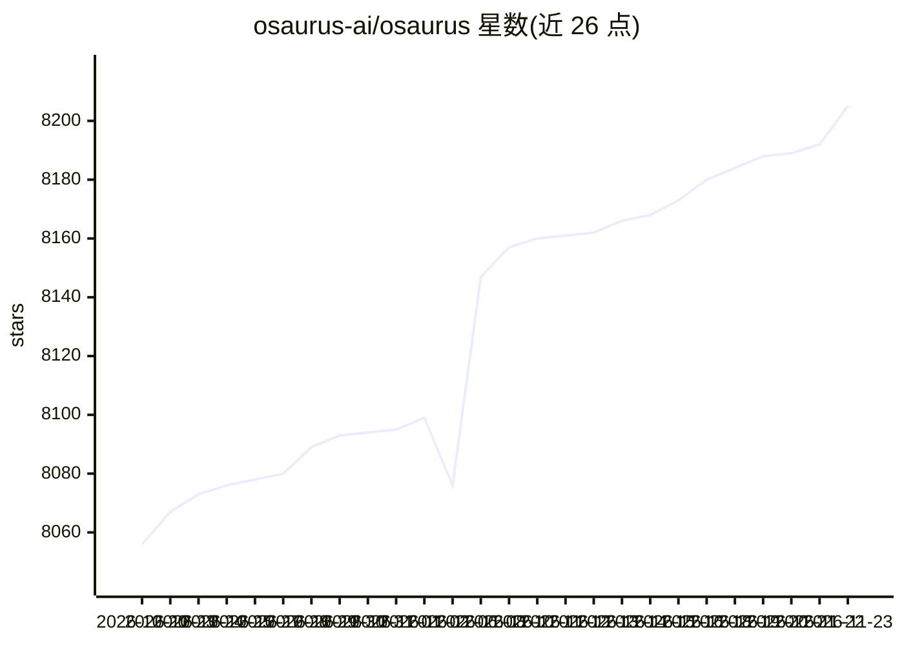

# osaurus-ai/osaurus

⭐ 8,205 · Swift · MIT · 推送 2026-11-22 · [GitHub](https://github.com/osaurus-ai/osaurus) · [官网](https://osaurus.ai) · 组织维护

**macOS 本地运行的端侧 AI 助手与 Agent 应用**

用 Swift 编写的 macOS 开源应用：一个 Orchestrator 助手调度多个绑定应用或文件夹的 Agent（Planner/Courier/Keeper 等），支持记忆、技能插件、工作流、定时自动化、浏览器/电脑使用与端到端加密身份。模型可换：本地 MLX 模型、Apple Foundation Models、云服务商或 Osaurus Cloud，Agent 与记忆在切换模型后保留。提供 OpenAI/Anthropic/Ollama 格式的本地 API 端点，可作 MCP server 与 client。需 macOS 15.5+ 与 Apple Silicon，沙箱 VM 需 macOS 26+。

## 筛选速览

| 维度 | 判定 | 备注 |
|---|---|---|
| AI 角色 | `ai-native` | 本体是模型或模型工具 |
| 许可风险 | `permissive` | MIT |
| 部署形态 | `desktop` | 安装包/桌面程序 |
| 模型依赖 | local-ok | 支持本地模型 |
| 硬件要求 | — | 无带数字的原话,不猜 |
| 安装摩擦 | `low` | 无编译、无系统依赖或容器化 |
| 成熟度 | — | 结构信号不足 |

## 能力要点

- 本地运行 MLX 模型（Gemma/Qwen/Llama 等），完全离线可用
- 多 Agent 团队、分层记忆、工作流与自动化调度
- 本地服务器提供 OpenAI/Anthropic/Ollama 兼容端点，双向 MCP
- 云发送前隐私过滤器：端侧替换姓名、邮箱、密钥等敏感信息

## 适用场景

- 在 Mac 上离线运行个人 AI 助手并保留长期记忆
- 让 Agent 操作日历、邮件、笔记等 Apple 原生应用
- 为已有工具提供本地 OpenAI 格式推理端点
- 定时或经 webhook 触发多步骤自动化工作流

## 场景标签

`AI 助手` `多智能体` `Agent 记忆` `工作流自动化` · 领域:Agent 开发

## 证据(README 行号)

> L6:  Agents, memory, tools, and identity that live on your Mac. Built purely in Swift. Fully offline. Open source.
> L47: - **Hands work to your team.** A fresh install comes with a small team of agents, each bound to one app or folder: 
> L78: - **Local**: Gemma, Qwen, GPT-OSS, Llama, LFM, and more, running on Apple Silicon through MLX. Osaurus publishes cu

## 星数曲线

2026-10-20 8,056 → 2026-11-23 8,205（+149）

---
*卡片 v1 · prompt 1.4 · 生成 2026-11-22 · 置信度 high · 依据 README sha `ab2a22162dce` · [字段定义](../../DATASET.md)*
