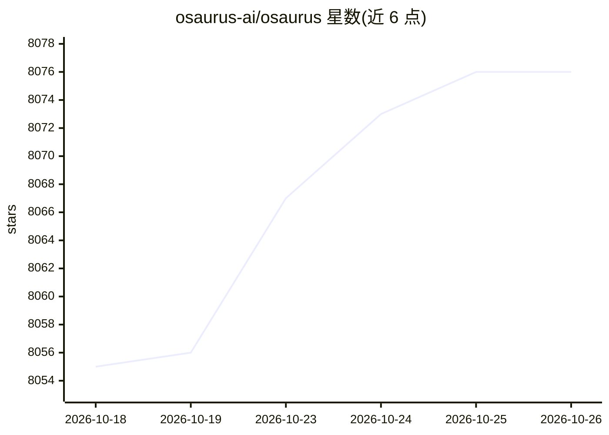

# osaurus-ai/osaurus

⭐ 8,076 · Swift · MIT · 推送 2026-10-25 · [GitHub](https://github.com/osaurus-ai/osaurus) · [官网](https://osaurus.ai) · 组织维护

**macOS 原生 AI agent 平台：本地/云端模型加持久记忆与沙箱执行**

用 Swift 编写的 macOS 应用，作为模型与用户之间的 harness：每个 agent 拥有独立提示词、记忆与主题；工具与技能经 RAG 检索自动选取。支持本地 MLX 模型（Gemma、Qwen、GPT-OSS 等）、Apple Foundation Models、Liquid AI 及 OpenAI/Anthropic/Gemini 等云端供应商。代码执行运行于 Apple Containerization 框架的 Linux VM（需 macOS 26+，旧版本回退到 Seatbelt 沙箱）。含三层记忆、隐私过滤（云端发送前用本地分类器脱敏）、secp256k1 密码学身份、agent 间端到端加密通道、浏览器使用与本地图像生成。要求 macOS 15.5+ 与 Apple Silicon。

## 筛选速览

| 维度 | 判定 | 备注 |
|---|---|---|
| AI 角色 | `ai-native` | 本体是模型或模型工具 |
| 许可风险 | `permissive` | MIT |
| 部署形态 | `desktop` | 安装包/桌面程序 |
| 模型依赖 | local-ok | 支持本地模型 |
| 硬件要求 | — | 无带数字的原话,不猜 |
| 安装摩擦 | `low` | 无编译、无系统依赖或容器化 |
| 成熟度 | — | 结构信号不足 |

## 能力要点

- 本地 MLX 推理 + 多云端供应商，agent/记忆/工具在换模型时保持不变
- 代码沙箱：Linux VM（macOS 26+）或 Seatbelt 回退
- 三层记忆结构与 salience 评分，后台整合衰减合并
- 发往云端前用本地 1.5B 分类器检测敏感信息并脱敏（fail-closed）
- 完整 MCP server，任意 MCP 客户端可接入其工具

## 适用场景

- 在 Mac 上完全离线运行带记忆的个人 AI agent
- 让 agent 在隔离沙箱中执行代码与文件任务
- 通过 relay 把本地 agent 暴露到互联网并加密通信
- 用本地模型离线生成图像

## 场景标签

`Agent 框架` `Agent 记忆` `图像生成` `浏览器自动化` · 领域:Agent 开发

## 证据(README 行号)

> L36: Osaurus is the AI harness for macOS. It sits between you and any model -- local or cloud -- and provides the contin
> L65: Agents are the core of Osaurus. Each one gets its own prompts, memory, and visual theme -- a research assistant, a 

## 星数曲线

2026-10-18 8,055 → 2026-10-26 8,076（+21）

---
*卡片 v1 · prompt 1.4 · 生成 2026-10-20 · 置信度 high · 依据 README sha `3da4c1b1b2ea` · [字段定义](../../DATASET.md)*
