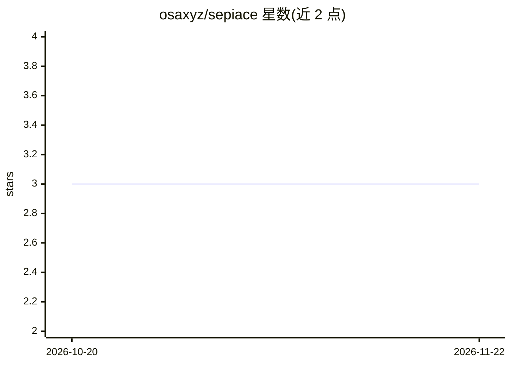

# osaxyz/sepiace

⭐ — · [GitHub]() · 组织维护

**给编码 agent 提供长期记忆的插件与托管服务**

sepiace 以一句话自然语言为接口，为 AI agent 提供记忆的保存、召回与遗忘。通过 npm 创建命令自动发现本机的 Claude Code、Codex、Cursor、VS Code、OpenCode 等客户端并完成接入，也支持作为远程 MCP 服务器连接。记忆从请求句子中切分生成，不做改写；每条记忆按 FSRS 遗忘曲线衰减，低于 50% 召回概率不再出现在搜索结果中。记忆存储在 sepiace 服务端并按账户隔离，目前处于 beta 阶段，README 提醒不要存储密码或密钥。

## 筛选速览

| 维度 | 判定 | 备注 |
|---|---|---|
| AI 角色 | `ai-ecosystem` | LLM/agent 周边工具 |
| 许可风险 | `permissive` | — |
| 部署形态 | `None` |  |
| 模型依赖 | — | README 未给出锁定关系 |
| 硬件要求 | — | 无带数字的原话,不猜 |
| 安装摩擦 | `low` | 无编译、无系统依赖或容器化 |
| 成熟度 | `idea` | |

## 能力要点

- 单一 memory 工具接收一句自然语言，服务端判定保存/召回/搜索/遗忘
- 记忆按 FSRS 遗忘曲线衰减，未被使用的记忆逐渐淡出
- 提供 migrate 技能将 Claude Code/Codex 本地记忆迁入，迁移前需用户确认
- 按账户隔离存储，控制台列出每次请求及变更的记忆

## 适用场景

- 让编码 agent 跨会话记住项目决策与个人偏好
- 把 Claude Code 或 Codex 已有的本地记忆迁移到统一存储
- 为其他 MCP 客户端接入远程长期记忆服务

## 场景标签

`Agent 记忆` · 领域:Agent 开发

## 证据(README 行号)

> L5: Long-term memory for AI agents. Your agent passes one natural-language sentence, and sepiace remembers, recalls, or 
> L19: It finds Claude Code, Codex, Cursor, VS Code, and OpenCode on your machine, connects the ones you choose, and walks
> L44: Other MCP clients: add `https://hi.sepiace.io/api/v1/mcp` as a remote MCP server (Streamable HTTP). The client sign

## 星数曲线

2026-10-20 3 → 2026-11-22 3（+0）

---
*卡片 v1 · prompt 1.4 · 生成 2026-11-21 · 置信度 high · 依据 README sha `599ce16f71d1` · [字段定义](../../DATASET.md)*
