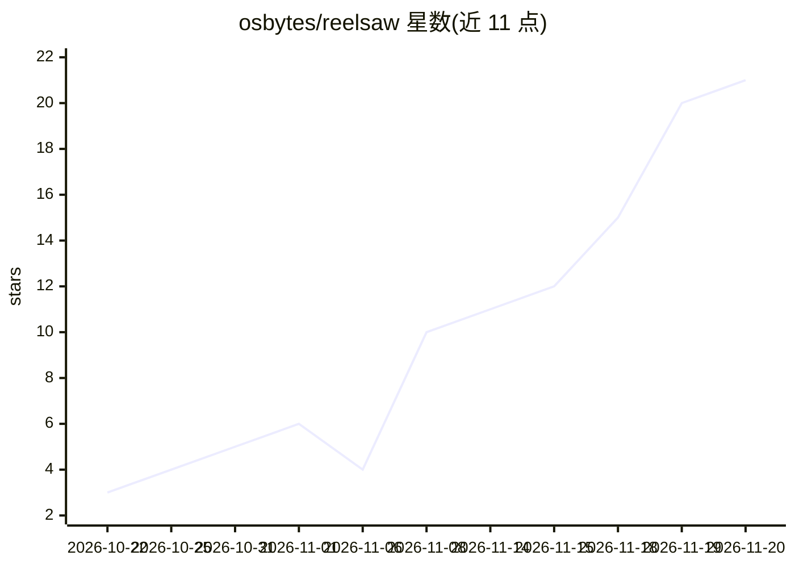

# osbytes/reelsaw

⭐ 21 · TypeScript · AGPL-3.0 · 推送 2026-11-19 · [GitHub](https://github.com/osbytes/reelsaw) · [官网](https://reelsaw.com/) · 组织维护

**自托管 AI 视频剪辑工具：长视频自动转竖屏短视频**

基于 TypeScript 的自托管 Web 应用：粘贴 YouTube 链接或上传视频后，经 ingest→转录→精修→选段→渲染五段流水线，由 LLM 评分挑选高光片段，渲染 9:16 竖屏短片，带逐词高亮字幕、hook 覆盖层与基于人脸检测的自动构图（face/split/stack/fit 四种布局）。语言模型、转录模型均为 provider:model 字符串，支持 OpenAI/Anthropic/Groq 等，也支持 Ollama、vLLM 等本地服务器实现全离线运行。Docker Compose 一步部署，附带托管版 app.reelsaw.com（AGPL-3.0）。提供剪辑编辑器、MCP 接口、CLI、Webhook 与分享链接。

## 筛选速览

| 维度 | 判定 | 备注 |
|---|---|---|
| AI 角色 | `ai-native` | 本体是模型或模型工具 |
| 许可风险 | `viral` | AGPL-3.0 |
| 部署形态 | `desktop` | 安装包/桌面程序 |
| 模型依赖 | local-ok | 支持本地模型 |
| 硬件要求 | — | 无带数字的原话,不猜 |
| 安装摩擦 | `low` | 无编译、无系统依赖或容器化 |
| 成熟度 | — | 结构信号不足 |

## 能力要点

- 五段流水线（转录→精修→配对排名选段→9:16 渲染）带断点续跑
- UltraFace(ONNX/CPU) 人脸跟踪自动构图，四种布局按场景切换
- filler 语气词经强制对齐定位后跳切核验，逐词字幕可拖拽定位
- 支持任意 OpenAI 兼容服务器（Ollama/vLLM 等），可全本地无 API key 运行

## 适用场景

- 把播客/访谈等长视频自动切成竖屏短视频发布
- 在本地离线运行完整剪辑流水线，不依赖云 API
- 通过 MCP/CLI/Webhook 把剪辑接入自动化工作流

## 场景标签

`图像视频处理` `工作流自动化` · 领域:效率与自动化

## 证据(README 行号)

> L11: Self-hosted, AI-powered long-form → short-form video clipper. Paste a YouTube link or upload a video; Reelsaw trans
> L35: - **Any AI vendor** – language model, transcription model and caption-alignment model are each a `provider:model` s

## 星数曲线

2026-10-22 3 → 2026-11-20 21（+18）

---
*卡片 v1 · prompt 1.4 · 生成 2026-11-18 · 置信度 mid · 依据 README sha `4830df3df3eb` · [字段定义](../../DATASET.md)*
