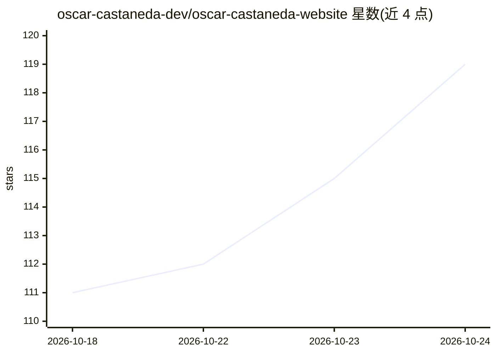

# oscar-castaneda-dev/oscar-castaneda-website

⭐ 119 · TypeScript · MIT · 推送 2026-07-02 · [GitHub](https://github.com/oscar-castaneda-dev/oscar-castaneda-website) · [官网](https://oscar-castaneda-website-brown.vercel.app/) · 个人维护

**个人作品集网站：展示全栈与 AI 工程工作**

Oscar Castaneda 的个人 portfolio 网站，自我介绍为专注 ML、NLP 与推理驱动产品的 AI 工程师。基于 Next.js 16、React 19、Tailwind CSS v4 构建，包含首页、关于、作品列表、项目案例页与设计系统参考页等路由。采用仅暗色的自定义设计系统，字体排版通过 Heading/Subtitle/Text 组件实现；使用 Husky 与 lint-staged 在每次提交时运行 ESLint 阻断含警告的提交。README 未展示任何 AI 功能实现，仅以文字描述作者背景。

## 筛选速览

| 维度 | 判定 | 备注 |
|---|---|---|
| AI 角色 | `ai-ecosystem` | LLM/agent 周边工具 |
| 许可风险 | `permissive` | MIT |
| 部署形态 | `None` |  |
| 模型依赖 | — | README 未给出锁定关系 |
| 硬件要求 | — | 无带数字的原话,不猜 |
| 安装摩擦 | `low` | 无编译、无系统依赖或容器化 |
| 成熟度 | — | 结构信号不足 |

## 能力要点

- Next.js 16 + React 19 + Tailwind CSS v4 技术栈
- 自定义 'Nothing' 设计系统（暗色模式，颜色/字体/间距以 Tailwind 工具类定义）
- Husky + lint-staged 提交时 ESLint 零警告门禁

## 适用场景

- 展示个人项目案例与技术背景
- 作为 portfolio 模板参考其设计系统组织方式

## 场景标签

 · 领域:个人网站/作品集

## 证据(README 行号)

> L5: Personal portfolio. AI Engineer specializing in ML, NLP, and inference-powered digital products.

## 星数曲线

2026-10-18 111 → 2026-10-24 119（+8）

---
*卡片 v1 · prompt 1.4 · 生成 2026-10-23 · 置信度 low · 依据 README sha `dd5d8ca0f229` · [字段定义](../../DATASET.md)*
