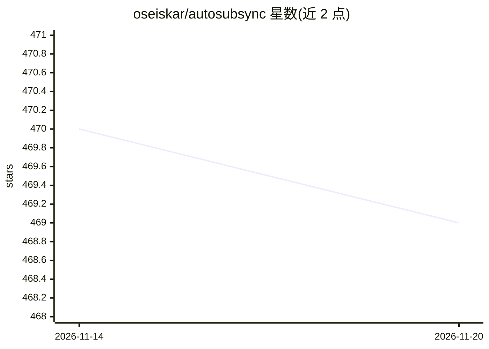

# oseiskar/autosubsync

⭐ 469 · Python · MIT · 推送 2026-11-14 · [GitHub](https://github.com/oseiskar/autosubsync) · 个人维护

**自动同步字幕与音频的命令行工具（ML 语音检测）**

无需人工干预即可将失步字幕与视频音频重新同步的 Python 命令行工具，面向观看带字幕电影的普通用户与开发者。机制：从音频计算频谱图并附加 rolling maximum 特征，用逻辑回归模型逐帧预测语音概率 p(t)；再对时间做线性变换 f(t)=at+b（b 为平移、a 为常见帧率比值的变速因子），以期望线性损失为目标做暴力网格搜索。典型同步误差约 0.15 秒，全片处理约 3 分钟、占用约 1.5 GB 内存。需预装 FFmpeg，经 pip 安装，另提供 Python API 与模型训练脚本。

## 筛选速览

| 维度 | 判定 | 备注 |
|---|---|---|
| AI 角色 | `ai-native` | 本体是模型或模型工具 |
| 许可风险 | `permissive` | MIT |
| 部署形态 | `library` | 以包/库形式分发 |
| 模型依赖 | — | README 未给出锁定关系 |
| 硬件要求 | — | 无带数字的原话,不猜 |
| 安装摩擦 | `medium` | 含编译或系统依赖之一 |
| 成熟度 | — | 结构信号不足 |

## 能力要点

- 自动平移与变速校正，无需人工干预
- 逻辑回归语音检测 + 线性时间变换网格搜索
- 支持任意语言的 SRT 文件，提供 Python API 与同步质量指标
- 可自行收集语料训练模型（train_and_test.sh）

## 适用场景

- 下载的公版电影字幕不同步时自动校正
- 批量同步一个文件夹内视频的字幕
- 修正因帧率不匹配导致的字幕变速偏移

## 场景标签

 · 领域:多媒体/字幕处理

## 证据(README 行号)

> L11: But fear not. This tool can resynchronize the subtitles without any human input.
> L93: The basic idea is to first detect speech on the audio track, that is, for each
> L116: label. This allows training a machine learning model to predict the labels, that

## 星数曲线

2026-11-14 470 → 2026-11-20 469（-1）

---
*卡片 v1 · prompt 1.4 · 生成 2026-11-17 · 置信度 high · 依据 README sha `56c60706171d` · [字段定义](../../DATASET.md)*
