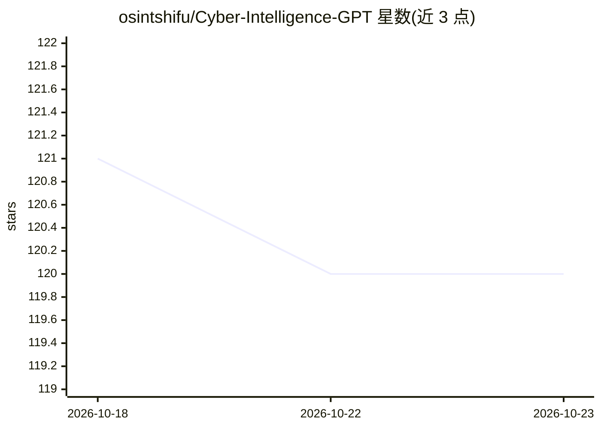

# osintshifu/Cyber-Intelligence-GPT

⭐ 120 · 推送 2026-10-09 · [GitHub](https://github.com/osintshifu/Cyber-Intelligence-GPT) · [官网](https://chatgpt.com/g/g-65xhTBjZu-cyber-intelligence-gpt) · 个人维护

**面向调查员的网络情报 Custom GPT：OSINT/DFIR/威胁情报调查与报告**

一个在 ChatGPT 中运行的定制 GPT（Custom GPT），面向合法授权的调查人员，覆盖 OSINT 公开足迹、企业情报、网络调查、威胁情报、数字取证、安全运营与 OPSEC 等领域。核心机制是八步情报循环（Frame→Plan→Collect→Pivot→Correlate→Challenge→Saturate→Assess），区分已验证事实/报告声明/推断等证据等级并给出置信度，默认输出完整 ChatGPT 报告与带引用的 Markdown 报告。无本地安装，通过 ChatGPT 打开使用；插件版本已宣布但未发布，无发布日期。

## 筛选速览

| 维度 | 判定 | 备注 |
|---|---|---|
| AI 角色 | `ai-native` | 本体是模型或模型工具 |
| 许可风险 | `none` | — |
| 部署形态 | `None` |  |
| 模型依赖 | — | README 未给出锁定关系 |
| 硬件要求 | — | 无带数字的原话,不猜 |
| 安装摩擦 | `low` | 无编译、无系统依赖或容器化 |
| 成熟度 | — | 结构信号不足 |

## 能力要点

- 八步情报循环（基于 ODNI ICD 203 分析实践，无官方隶属）
- 证据分级：verified/reported/inference/hypothesis 加高中低置信度
- 默认双交付物：完整 ChatGPT 报告 + 带完整来源 URL 的 Markdown 报告
- 18 个聊天命令（Case/Report/Enrich/Timeline/Mitre 等）覆盖调查场景

## 适用场景

- 对域名、IP、组织做全谱公开足迹调查并生成可溯源报告
- 威胁事件取证分析、IOC 关联与 ATT&CK 映射
- 查找并比较 FOSS OSINT 工具与调查 playbook
- 按 PIR/SIR 结构化开展合规的公开情报研究

## 场景标签

`网络安全` · 领域:学习与行业

## 证据(README 行号)

> L17: **Cyber Intelligence GPT** supports OSINT, cyber threat intelligence, digital forensics, incident response, corpora
> L25: **Cyber Intelligence Plugin - coming soon.** The Custom GPT is available now; a plugin version is planned to bring 
> L29: |**Cyber Intelligence GPT**|Available now|

## 星数曲线

2026-10-18 121 → 2026-10-23 120（-1）

---
*卡片 v1 · prompt 1.4 · 生成 2026-10-23 · 置信度 high · 依据 README sha `4fd8d460f9e3` · [字段定义](../../DATASET.md)*
