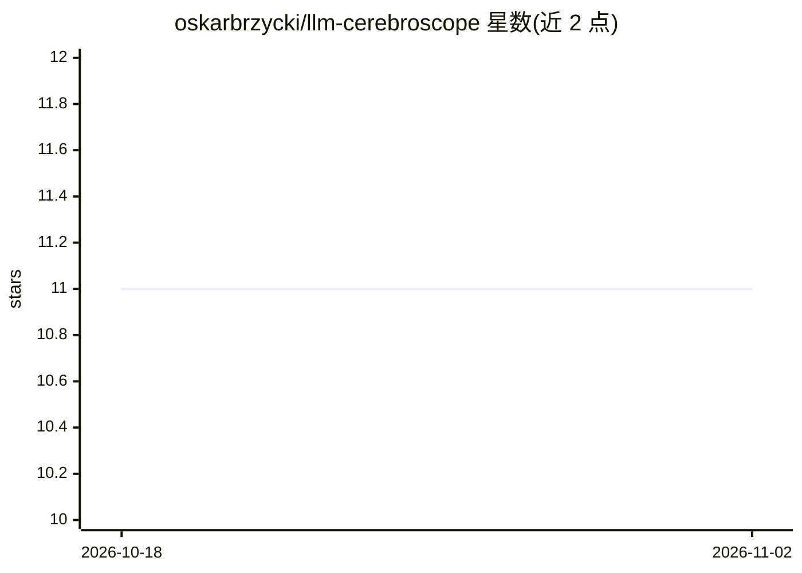

# oskarbrzycki/llm-cerebroscope

⭐ 11 · Python · MIT · 推送 2026-05-07 · [GitHub](https://github.com/oskarbrzycki/llm-cerebroscope) · 个人维护

**本地取证式文档分析平台：RAG 问答+引用溯源+矛盾检测**

面向需要可审计、可溯源文档分析的专业用户的 Python 平台。以 ChromaDB 做向量存储，接入 Ollama 进行本地推理（无云端依赖），支持 PDF/CSV/TXT/XLSX 多格式摄取与可配置分块。回答自动附带 chunk 级引用标识，提供 LLM 驱动的矛盾检测、基于元数据的来源可靠性评分、spaCy NER 知识图谱可视化与 Markdown 报告生成。提供 CLI 与 Streamlit Web 双界面，功能对等。运行需 Python 3.8+、Ollama，spaCy 模型为可选。

## 筛选速览

| 维度 | 判定 | 备注 |
|---|---|---|
| AI 角色 | `ai-native` | 本体是模型或模型工具 |
| 许可风险 | `permissive` | MIT |
| 部署形态 | `library` | 以包/库形式分发 |
| 模型依赖 | local-ok | 支持本地模型 |
| 硬件要求 | — | 无带数字的原话,不猜 |
| 安装摩擦 | `low` | 无编译、无系统依赖或容器化 |
| 成熟度 | — | 结构信号不足 |

## 能力要点

- 回答附带 chunk 级引用追踪与证据卡片（用/未用片段区分）
- LLM 驱动的矛盾检测与基于元数据的来源可靠性评分
- Ollama 本地推理，处理过程无云端依赖
- CLI 与 Streamlit GUI 双界面，支持知识图谱可视化与报告导出

## 适用场景

- 检索案件卷宗、识别先例并检测矛盾表述
- 分析论文集中相互冲突的方法论并抽取实体
- 查询财务报表并生成带审计痕迹的合规报告
- 构建带可追溯引用的内部知识库问答

## 场景标签

`文档问答` `知识图谱` · 领域:知识与检索

## 证据(README 行号)

> L19: **LLM-CerebroScope** is a sophisticated forensic data analysis platform that combines Large Language Models (LLMs) 
> L23: - **LLM-Powered Analysis**: Integration with Ollama for local, privacy-preserving inference

## 星数曲线

2026-10-18 11 → 2026-11-02 11（+0）

---
*卡片 v1 · prompt 1.4 · 生成 2026-11-01 · 置信度 mid · 依据 README sha `37ef227746b0` · [字段定义](../../DATASET.md)*
