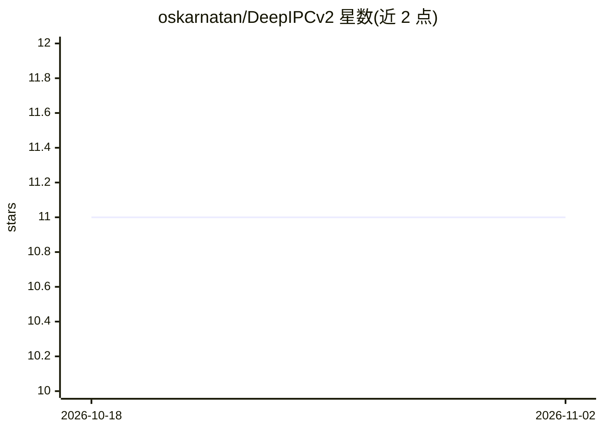

# oskarnatan/DeepIPCv2

⭐ 11 · Python · MIT · 推送 2026-01-12 · [GitHub](https://github.com/oskarnatan/DeepIPCv2) · [官网](https://oskarnatan.staff.ugm.ac.id/) · 个人维护

**自动驾驶车端感知与导航控制的深度学习实现代码**

论文 DeepIPCv2（IEEE Access 2025）的官方实现代码：面向自动驾驶车辆，基于 LiDAR 的环境感知与端到端导航控制，主题涵盖深度学习与传感器融合。仓库内 xr20 目录与 TF 目录给出运行步骤，AUTO DRIVING RECORD 部分含数据记录。README 声明代码仅用于离线测试，在线测试需用户自行搭建车辆环境。文档信息较少，细节需进入子目录查看。

## 筛选速览

| 维度 | 判定 | 备注 |
|---|---|---|
| AI 角色 | `ai-native` | 本体是模型或模型工具 |
| 许可风险 | `permissive` | MIT |
| 部署形态 | `None` |  |
| 模型依赖 | — | README 未给出锁定关系 |
| 硬件要求 | — | 无带数字的原话,不猜 |
| 安装摩擦 | `low` | 无编译、无系统依赖或容器化 |
| 成熟度 | — | 结构信号不足 |

## 能力要点

- LiDAR 驱动的环境感知与导航控制实现
- 端到端自动驾驶方案（含传感器融合）
- 提供 xr20 与 TF 目录的分步运行说明

## 适用场景

- 复现 DeepIPCv2 论文的离线实验
- 在自建车辆平台上进行在线测试的参考实现
- 研究 LiDAR 感知与导航控制的融合方法

## 场景标签

`目标检测` · 领域:感知与多模态

## 证据(README 行号)

> L3: O. Natan and J. Miura, “DeepIPCv2: LiDAR-powered Robust Environmental Perception and Navigational Control for Autono
> L5: paper: http://doi.org/10.1109/ACCESS.2025.3647530 video: https://www.youtube.com/watch?v=IsZ1HP5QjWc

## 星数曲线

2026-10-18 11 → 2026-11-02 11（+0）

---
*卡片 v1 · prompt 1.4 · 生成 2026-11-01 · 置信度 mid · 依据 README sha `9bcb31b210ac` · [字段定义](../../DATASET.md)*
