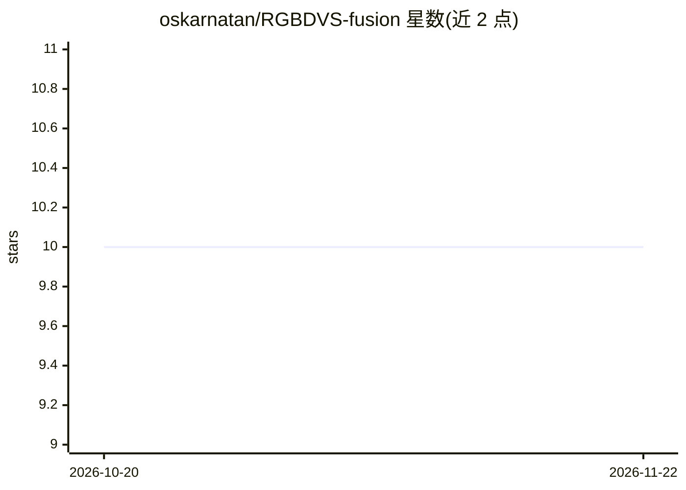

# oskarnatan/RGBDVS-fusion

⭐ 10 · Python · MIT · 推送 2026-04-12 · [GitHub](https://github.com/oskarnatan/RGBDVS-fusion) · [官网](https://oskarnatan.staff.ugm.ac.id/) · 个人维护

**论文代码：RGB 与事件相机融合的分割与深度估计**

ACPR 2021 论文的实现代码，任务是在多视角驾驶感知场景中，用 RGB 相机与 DVS（动态视觉传感器）融合进行语义分割与深度估计。README 给出四步流程：下载数据集到 dataset 子目录、在 train.py 中检查配置、运行 python3 train.py 训练并在 model 子目录保存模型与元数据、运行 python3 predict.py 生成预测结果到 prediction 子目录。未包含安装依赖说明。

## 筛选速览

| 维度 | 判定 | 备注 |
|---|---|---|
| AI 角色 | `ai-native` | 本体是模型或模型工具 |
| 许可风险 | `permissive` | MIT |
| 部署形态 | `None` |  |
| 模型依赖 | — | README 未给出锁定关系 |
| 硬件要求 | — | 无带数字的原话,不猜 |
| 安装摩擦 | `low` | 无编译、无系统依赖或容器化 |
| 成熟度 | — | 结构信号不足 |

## 能力要点

- RGB 与 DVS 传感器融合的语义分割与深度估计实现
- 配套 ACPR 2021 论文并附 DOI 链接
- train.py / predict.py 的训练与预测脚本流程

## 适用场景

- 复现论文的 RGB+DVS 融合分割与深度估计结果
- 在驾驶感知数据集上训练多传感器融合模型
- 参考传感器融合的模型实现

## 场景标签

`目标检测` · 领域:感知与多模态

## 证据(README 行号)

> L1: # Semantic Segmentation and Depth Estimation with RGB and DVS Sensor Fusion for Multi-view Driving Perception
> L3: O. Natan and J. Miura, "Semantic Segmentation and Depth Estimation with RGB and DVS Sensor Fusion for Multi-view Dri
> L13: 3. python3 train.py, model and other metadata will be saved in subfolder model

## 星数曲线

2026-10-20 10 → 2026-11-22 10（+0）

---
*卡片 v1 · prompt 1.4 · 生成 2026-11-19 · 置信度 high · 依据 README sha `f809277140b2` · [字段定义](../../DATASET.md)*
