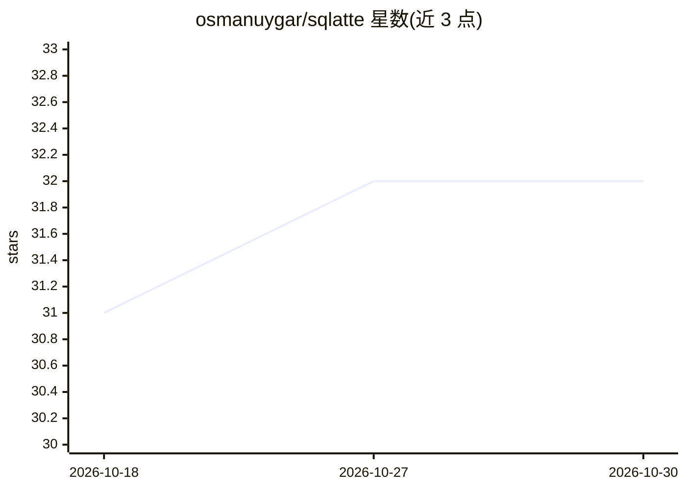

# osmanuygar/sqlatte

⭐ 32 · Python · MIT · 推送 2026-10-21 · [GitHub](https://github.com/osmanuygar/sqlatte) · [官网](https://osmanuygar.github.io/sqlatte-docs/) · 个人维护

**面向分析师与 AI agent 的受治数据层：自然语言转 SQL 统一管控**

在数据库与用户/AI 代理之间提供治理层：分析师用聊天界面提问，AI 代理通过原生 MCP server（stdio/SSE/Streamable HTTP）接入，所有查询统一经过意图检测→SQL 生成→验证→审计流程。提供短时效 token、字段掩码（hash/partial/redact）、目录/模式级权限限制、多租户与可选 LDAP 认证。含语义层（业务名/JOIN/指标定义）、自动图表与仪表盘、AI 洞察引擎、BigQuery 运维控制台、定时查询与审计日志。LLM 由 Anthropic Claude 提供，Python 3.8+，支持 Trino/BigQuery/Postgres，源码安装运行。

## 筛选速览

| 维度 | 判定 | 备注 |
|---|---|---|
| AI 角色 | `ai-native` | 本体是模型或模型工具 |
| 许可风险 | `permissive` | MIT |
| 部署形态 | `self-host` | docker 或自建部署 |
| 模型依赖 | locked-api |  |
| 硬件要求 | — | 无带数字的原话,不猜 |
| 安装摩擦 | `low` | 无编译、无系统依赖或容器化 |
| 成熟度 | — | 结构信号不足 |

## 能力要点

- 原生 MCP server，三种传输模式（stdio/SSE/Streamable HTTP）
- 人与 AI 查询共用同一验证与审计管道，无未审计路径
- 短时效 token、字段级掩码、一键吊销的凭据隔离机制
- 语义层、自动图表、AI 洞察与 BigQuery 运维控制台

## 适用场景

- 让分析师用自然语言查询数据仓库并获得图表结果
- 给 AI 代理提供受控、可审计的数据仓库访问而不下发原始凭据
- SaaS 产品通过可嵌入 widget 加入对话式数据界面
- 企业对 LLM 调用与查询做合规审计与成本追踪

## 场景标签

`数据分析` · 领域:效率与自动化

## 证据(README 行号)

> L18: Most teams give AI assistants raw database credentials. SQLatte sits in between: short-lived tokens, schema-scoped 
> L20: **The core guarantee:** whether a query is typed by a human or generated by an AI agent, it goes through the same i
> L41: SQLatte is a native MCP server. Any MCP-compatible client — Claude Desktop, Claude Code, or a custom agent — gets c

## 星数曲线

2026-10-18 31 → 2026-10-30 32（+1）

---
*卡片 v1 · prompt 1.4 · 生成 2026-10-26 · 置信度 mid · 依据 README sha `83cff1063f60` · [字段定义](../../DATASET.md)*
