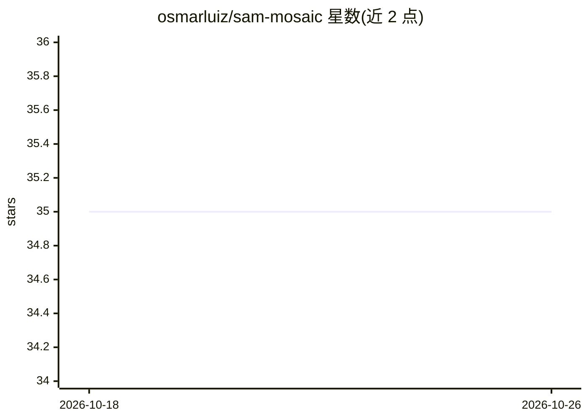

# osmarluiz/sam-mosaic

⭐ 35 · Python · MIT · 推送 2026-08-07 · [GitHub](https://github.com/osmarluiz/sam-mosaic) · [官网](https://arxiv.org/abs/2605.00256) · 个人维护

**用 SAM2 对超大遥感影像做零样本分块的分割工具**

基于 SAM2 的遥感影像分割 Python 包（CLI + API），处理超出 GPU 内存的卫星/航空/无人机影像：按瓦片多轮分割（阈值递减、黑掩码聚焦残余区域、Dense Grid 点策略），再用 LUT + Union-Find 做瓦片边界免参数合并，实现恒定显存处理任意大小影像。零样本无微调，在 5cm–4.78m GSD 多场景下覆盖 91–98%（最大测试 19.4 亿像素），输出 GeoTIFF 标签、Shapefile/GeoPackage 矢量与统计文件，保留 CRS 地理参考。需 NVIDIA GPU（推荐 8GB+ 显存）与 CUDA，SAM2 采用 PyPI 的 JinsuaFeito-dev fork 版本而非官方 Facebook 仓库。附 arXiv 论文，提供消融实验接口。

## 筛选速览

| 维度 | 判定 | 备注 |
|---|---|---|
| AI 角色 | `ai-native` | 本体是模型或模型工具 |
| 许可风险 | `permissive` | MIT |
| 部署形态 | `library` | 以包/库形式分发 |
| 模型依赖 | — | README 未给出锁定关系 |
| 硬件要求 | `gpu-8g` | |
| 安装摩擦 | `medium` | 含编译或系统依赖之一 |
| 成熟度 | — | 结构信号不足 |

## 能力要点

- 瓦片化 + 多轮递减阈值分割，零样本达 91–98% 覆盖
- LUT + Union-Find 免参数瓦片边界合并（O(n)）
- 输出 GeoTIFF 标签与 Shapefile/GeoPackage 矢量，保留 CRS 地理参考
- 恒定 GPU 显存处理任意大小影像（测试至 19.4 亿像素）

## 适用场景

- 对超出显存的卫星/航空大影像做全图自动分割
- 面向地理分析的遥感地物边界提取与矢量化输出
- 复现论文实验或做多 pass/阈值消融研究

## 场景标签

`目标检测` · 领域:感知与多模态

## 证据(README 行号)

> L11: Segment large remote sensing images (satellite, aerial, drone) that exceed GPU memory by processing them in tiles a
> L193: After all tiles are processed, segments touching at tile boundaries are reconciled through a **best-match merge**:

## 星数曲线

2026-10-18 35 → 2026-10-26 35（+0）

---
*卡片 v1 · prompt 1.4 · 生成 2026-10-25 · 置信度 mid · 依据 README sha `a15e5e567e71` · [字段定义](../../DATASET.md)*
