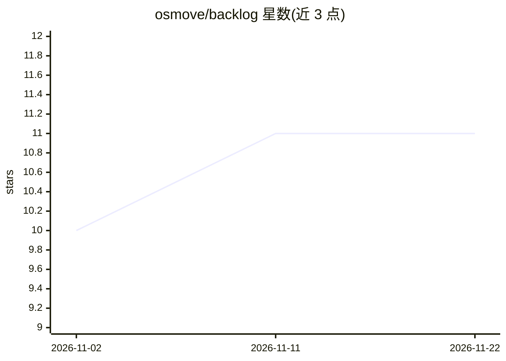

# osmove/backlog

⭐ 11 · TypeScript · NOASSERTION · 推送 2026-07-04 · [GitHub](https://github.com/osmove/backlog) · 个人维护

**AI 编码代理的任务编排器：把 backlog 变为可审查的代理工作**

运行于本地与 Git 仓库之间的任务编排引擎：从 Markdown、CSV、Jira、GitHub Issues 等来源摄入任务，拆分为子任务，用文件作用域 claim 与隔离 worktree 支持多代理并行执行，带重试、实时活动、token 用量与可选 review 流程。产品家族含 CLI、桌面端（macOS/Linux/Windows）与 TypeScript SDK，核心为 Apache-2.0；托管云版在私有开发中。默认全本地运行，无需账号。

## 筛选速览

| 维度 | 判定 | 备注 |
|---|---|---|
| AI 角色 | `ai-ecosystem` | LLM/agent 周边工具 |
| 许可风险 | `none` | NOASSERTION |
| 部署形态 | `library` | 以包/库形式分发 |
| 模型依赖 | — | README 未给出锁定关系 |
| 硬件要求 | — | 无带数字的原话,不猜 |
| 安装摩擦 | `low` | 无编译、无系统依赖或容器化 |
| 成熟度 | — | 结构信号不足 |

## 能力要点

- 三种执行器：claude、codex 与任意自定义 shell 命令
- 文件作用域 claim + Git worktree 隔离，支持多代理并行
- CLI / 桌面看板 / SDK 三形态共用同一引擎
- 从 Markdown/CSV/Jira/GitHub Issues 同步任务并处理冲突

## 适用场景

- 把待办清单拆解后分派给 Claude Code / Codex 等代理并行执行
- 在 CI 中以无头方式脚本化运行代理任务
- 多个代理同时改动同一仓库时避免路径冲突
- 对代理产出的运行结果做人工审查与变更检视

## 场景标签

`编码 Agent` `多智能体` · 领域:Agent 开发

## 证据(README 行号)

> L3: **The task orchestrator for AI coding agents.**
> L29: Backlog is the engine that sits between your backlog and your agents.
> L234: Backlog ships with three executor providers:

## 星数曲线

2026-11-02 10 → 2026-11-22 11（+1）

---
*卡片 v1 · prompt 1.4 · 生成 2026-11-19 · 置信度 high · 依据 README sha `8b5161e5c041` · [字段定义](../../DATASET.md)*
