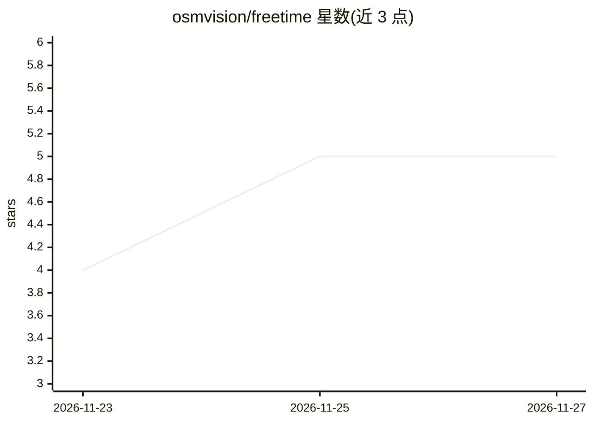

# osmvision/freetime

⭐ 5 · HTML · MIT · 推送 2026-11-22 · [GitHub](https://github.com/osmvision/freetime) · [官网](https://osmvision.github.io/freetime/) · 个人维护

**按时间/精力/预算推荐休闲活动的桌面与终端应用**

freetime 根据用户输入的可用时间、精力、同行者、是否外出和预算，对多来源的活动点子（Steam 游戏库、YouTube 视频、运动、自建点子等）进行排序并给出推荐理由，通过 👍/👎 反馈调整排序。默认无需任何配置即可运行（内置点子 + Steam 商店榜单 + YouTube 频道 RSS），可选接入 Open-Meteo 天气、Overpass/OSM 地点、Steam 导入与 API key。提供 Windows 安装包下载，也支持 cargo 运行桌面版（Tauri）和终端版。

## 筛选速览

| 维度 | 判定 | 备注 |
|---|---|---|
| AI 角色 | `ai-native` | 本体是模型或模型工具 |
| 许可风险 | `permissive` | MIT |
| 部署形态 | `library` | 以包/库形式分发 |
| 模型依赖 | — | README 未给出锁定关系 |
| 硬件要求 | — | 无带数字的原话,不猜 |
| 安装摩擦 | `low` | 无编译、无系统依赖或容器化 |
| 成熟度 | — | 结构信号不足 |

## 能力要点

- 按时间/精力/同伴/天气/预算对多来源点子统一排序并解释理由
- Steam 本地导入通过白名单只读指定文件，不上传
- 默认零配置：内置点子、Steam 商店榜单、YouTube 频道 RSS
- Tauri 桌面版与终端 CLI 两种运行形态

## 适用场景

- 周末有 2 小时空闲，让应用从游戏库和视频里挑一件事做
- 根据当地天气获得户外运动建议
- 查找附近的公园、泳池、图书馆等可去的场所
- 把自己的点子加入候选一并参与排序

## 场景标签

`推荐系统` · 领域:学习与行业

## 证据(README 行号)

> L7: Tell it how much time you have, your energy, who's with you, whether you'll go outside and your
> L8: budget. It ranks ideas from every source, explains why, and learns from your 👍 / 👎.

## 星数曲线

2026-11-23 4 → 2026-11-27 5（+1）

---
*卡片 v1 · prompt 1.4 · 生成 2026-11-23 · 置信度 low · 依据 README sha `c862064e20d8` · [字段定义](../../DATASET.md)*
