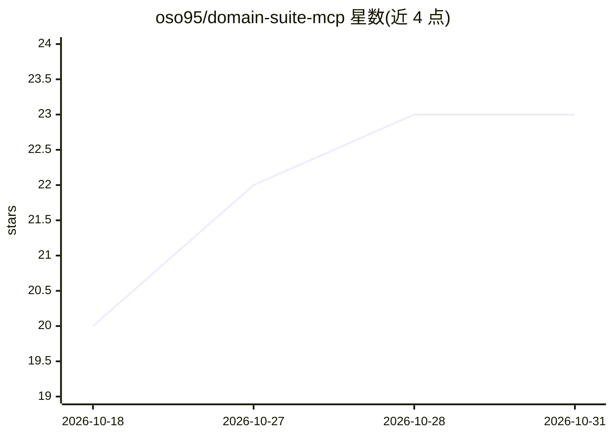

# oso95/domain-suite-mcp

⭐ 23 · TypeScript · MIT · 推送 2026-03-12 · [GitHub](https://github.com/oso95/domain-suite-mcp) · [官网](https://www.npmjs.com/package/domain-suite-mcp) · 个人维护

**让 AI agent 自主管理域名与 DNS 的 MCP 服务器**

TypeScript 编写的开源 MCP 服务器，作为统一抽象层对接 Porkbun、Namecheap、GoDaddy、Cloudflare 四家域名注册商与 DNS 服务商 API，向 MCP 兼容 agent 暴露 21 个工具，覆盖域名查询、注册、续费、DNS CRUD、SSL 证书、SPF/DKIM/DMARC/MX 邮件记录配置与转入等。域名可用性查询通过公共 RDAP/WHOIS 无需配置即可用；注册等操作需通过环境变量提供各服务商凭据。提供 5 个 Claude Code 预置技能，服务器完全无状态。

## 筛选速览

| 维度 | 判定 | 备注 |
|---|---|---|
| AI 角色 | `ai-ecosystem` | LLM/agent 周边工具 |
| 许可风险 | `permissive` | MIT |
| 部署形态 | `library` | 以包/库形式分发 |
| 模型依赖 | — | README 未给出锁定关系 |
| 硬件要求 | — | 无带数字的原话,不猜 |
| 安装摩擦 | `low` | 无编译、无系统依赖或容器化 |
| 成熟度 | — | 结构信号不足 |

## 能力要点

- 统一抽象 4 家域名/DNS 服务商 API，暴露 21 个 MCP 工具
- 域名可用性查询零配置，基于公共 RDAP/WHOIS
- 内置 SPF/DKIM/DMARC/MX 邮件记录配置工具
- 面向 agent 的结构化错误信息（错误码+原因+下一步操作）

## 适用场景

- 让 AI agent 端到端完成域名查询、注册与 DNS 配置
- 通过 Claude Code 技能命令一键完成域名全流程设置
- 跨多家注册商统一管理域名与 SSL 证书

## 场景标签

 · 领域:开发者工具/域名管理

## 证据(README 行号)

> L10: `domain-suite-mcp` is an open-source MCP server written in TypeScript that enables AI agents to autonomously manage
> L182: ## Designed for AI Agents

## 星数曲线

2026-10-18 20 → 2026-10-31 23（+3）

---
*卡片 v1 · prompt 1.4 · 生成 2026-10-27 · 置信度 high · 依据 README sha `11d32dfd4713` · [字段定义](../../DATASET.md)*
