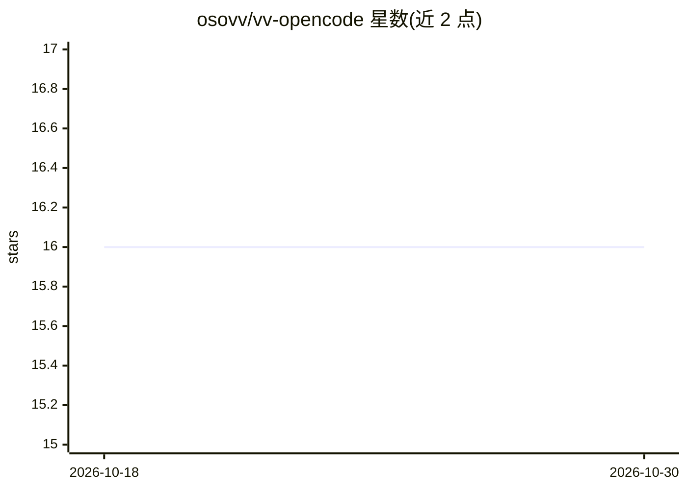

# osovv/vv-opencode

⭐ 16 · TypeScript · MIT · 推送 2026-10-26 · [GitHub](https://github.com/osovv/vv-opencode) · [官网](https://www.npmjs.com/package/@osovv/vv-opencode) · 个人维护

**OpenCode 之上的规范优先代理开发流程层**

以 OpenCode 插件、托管 agent、技能和 vvoc CLI 形式发布的开发流程层：OpenCode 负责流式传输、模型调用与沙箱，本产品补充 spec→plan→execute 流水线、审查门控、可移植模型角色（vv-role:smart/fast 等）、多 agent 状态机、秘密脱敏、每模型编辑工具路由与长时运行安全（Guardian 自动批准低风险权限）。仅支持 OpenCode >=2.0.18 <2.0.19，通过 bun/npm 安装，vvoc install 完成配置。

## 筛选速览

| 维度 | 判定 | 备注 |
|---|---|---|
| AI 角色 | `ai-ecosystem` | LLM/agent 周边工具 |
| 许可风险 | `permissive` | MIT |
| 部署形态 | `library` | 以包/库形式分发 |
| 模型依赖 | — | README 未给出锁定关系 |
| 硬件要求 | — | 无带数字的原话,不猜 |
| 安装摩擦 | `low` | 无编译、无系统依赖或容器化 |
| 成熟度 | — | 结构信号不足 |

## 能力要点

- spec→plan→execute 流水线，产物保存为可 grep 的 XML（spec.xml/plan.xml）
- 可移植模型角色映射，一条 preset 命令切换模型栈
- 按模型路由编辑工具（DeepSeek/GLM/Qwen/Kimi/GPT 各得其所，未匹配走 hashline_edit）
- Guardian 自动批准低风险权限、秘密在到达模型前脱敏、多 agent 工作走显式状态机

## 适用场景

- 让 OpenCode 上的代理开发遵循 spec 先行与审查门控
- 长时/挂机运行时代理工作不因权限提示中断
- 在多台机器或多个项目中复现同一代理工作流配置
- 统一多模型的编辑与 web 工具契约，避免提供商特定 schema 泄入提示词

## 场景标签

`Agent 框架` `多智能体` · 领域:Agent 开发

## 证据(README 行号)

> L3: **An opinionated agentic development layer for OpenCode** — spec-first when it matters, review-driven execution, por
> L12: OpenCode owns the mechanics: streaming, model invocation, sandboxing, permissions. The development *process* — when

## 星数曲线

2026-10-18 16 → 2026-10-30 16（+0）

---
*卡片 v1 · prompt 1.4 · 生成 2026-10-30 · 置信度 high · 依据 README sha `f70b0b61ffc4` · [字段定义](../../DATASET.md)*
